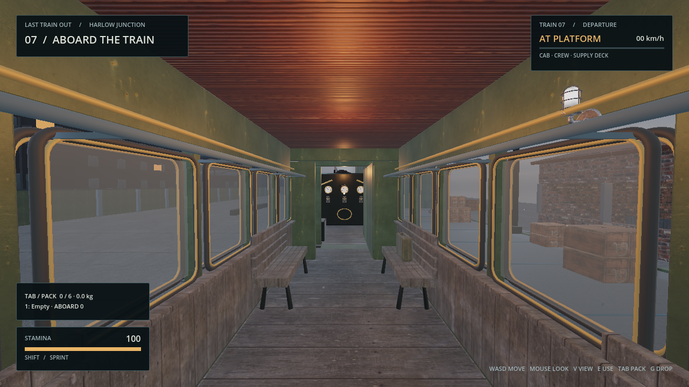

# Last Train Out — Milestone 3.5.4 macOS renderer acceptance

This draft combines PR #4’s detailed survivor, locomotive and Harlow art with PR #5’s continuous three-station survival journey. Press **J** for Save / Continue / New / Restart and **V** to switch camera. [Integration history](docs/MILESTONE3_INTEGRATION.md)

**Hold the merge.** The optional native Metal build fixes the viewport sampler warning on Apple Silicon. Its matched steady median was 7.0 ms, with a 1.084-second Warehouse A entry frame. The default Vulkan executable lost its device during a fresh hosted ARM gameplay test. The owner’s physical 2020 M1 fullscreen check remains pending. [Draft PR #6](https://github.com/oiwdis/last-train-out/pull/6) · [Performance and stability report](docs/PERFORMANCE_MILESTONE354.md) · [All 36 paired views](docs/validation/milestone354/matched/README.md) · [Physical M1 procedure](docs/M1_MILESTONE354.md)

[Download the tested universal development ZIP](https://github.com/oiwdis/last-train-out/actions/runs/44781367462/artifacts/14653133684) · [ZIP checksum and architecture details](docs/validation/milestone354/build-86.json) · [Full native Metal journey](docs/recording/milestone354-native-metal.mp4) · [Character comparison](docs/validation/milestone354/gallery/character.jpg) · [Train and station comparison](docs/validation/milestone354/gallery/train-and-station.jpg)

The reports below describe their respective source milestones.

> Milestone 3 now opens **The Harlow Escape**, a continuous three-station survival mission. Press **J** for route progress, Save / Continue / New / Restart. See [journey, controls and save format](docs/MILESTONE3_JOURNEY.md) and [PR #4 integration notes](docs/MILESTONE3_INTEGRATION.md).

> [Finalization tests, scenarios and screenshots](docs/MILESTONE3_FINALIZATION_VALIDATION.md) · [Continuous gameplay video](docs/validation/milestone3-finalization/harlow-escape-continuous.mp4) · [Performance comparison](docs/PERFORMANCE_MILESTONE3_FINALIZATION.md). Current macOS download and build checks are linked on [draft PR #5](https://github.com/oiwdis/last-train-out/pull/5).

# Milestone 3: advancing fog

This branch adds survival pressure to the stable M2.5 gameplay baseline. See [Milestone 3](docs/MILESTONE_3.md), [fog architecture](docs/FOG_ARCHITECTURE.md) and [balancing](docs/FOG_BALANCING.md). F3 shows fog diagnostics; R restarts after fog death. E at the locomotive bunker burns one coal sack from train storage. Closed doors reduce exposure, but no interior is immune.

The historical milestone notes below describe the baseline. Milestone 3 validation and remaining scope are tracked separately in the linked report.

# Last Train Out

A survival adventure about the operator of the last working train in a city being swallowed by fog.
**Milestone 2.6** replaces the blockout worker with a licensed, skinned human and animations,
adds an authored steam locomotive and industrial props, and improves the train interiors.
The environment continuation adds modeled factory facades, recessed windows, pitched roofs,
weathered benches, detailed freight vans/containers and replacement supply props.
The finalization adds improved skin/eyes/hair, complete first-person wrists, foot and
cargo contacts, moving locomotive rods, live gauges and damaged warehouse finishing.
Full 3D movement, perspective switching, scavenging and moving-train gameplay remain.
Built in **Godot 4.5.1 and GDScript**, with original project art and commercially usable CC0 models, animations and PBR materials.

Search the station, fill a six-slot backpack, carry bulky supplies back to the train,
and secure them in its hold. Enter the cab, choose a departure mode, and start the train.
Its existing acceleration, moving-platform physics, climbing and inventory rules remain.


| | |
|---|---|
| Engine | Godot **4.5.1** (the version used for this milestone's tests and exports) |
| Language | GDScript |
| Renderer | Desktop Forward+ with Vulkan/MoltenVK by default on macOS and optional native Metal on Apple Silicon |
| Physics | Jolt Physics, 60 ticks/s, physics interpolation on |
| macOS app | Built automatically by GitHub Actions for Apple Silicon and Intel - [download and play](#play-on-macos-no-godot-needed) |
| Status | [Finalization review, validation and limitations](docs/FINALIZATION_REVIEW.md) |

[Watch the finalization tour](docs/recording/milestone26_finalization_tour.mp4): movement,
perspective switching, moving-car traversal, scavenging, carrying and gantry climbing.
The recording uses scripted gameplay
inputs and explicit location cuts; it is not a frame-rate measurement.
[Art and asset credits](docs/ASSET_CREDITS.md).
[Environment continuation and matched screenshots](docs/ENVIRONMENT_PASS.md).
[Watch the environment tour](docs/recording/environment_tour.mp4) and
[review its measured rendering comparison](docs/PERFORMANCE_ENVIRONMENT.md).
Graphics default to **Medium**. On a 2020 M1 Mac in full-screen, try **Low** using
**F2** (often **Fn+F2** on Mac) or **Tab → Graphics**. Low and Medium cap 3D rendering
resolution while keeping the interface sharp. Startup and preset changes can show
“Preparing scene…” while destination-GPU pipelines are prepared; gameplay pauses
during this loading step. [Matched performance comparison and limitations](docs/PERFORMANCE_MILESTONE26.md).
[Three-way final comparison gallery](docs/FINALIZATION_GALLERY.md),
[final performance comparison](docs/PERFORMANCE_FINALIZATION.md) and
[physical M1 fullscreen benchmark procedure](docs/M1_BENCHMARK.md).
Close-up character rendering and some distant geometry remain below a photorealistic
reference; physical 2020 M1 fullscreen performance remains unverified.

---

## Play on macOS (no Godot needed)

The development build opens with Forward+ on Vulkan. On Apple Silicon, quit the game and use its bundled selector to evaluate native Metal. In Terminal, run the following command with the path to your app. Use `vulkan` in the same command for the experimental comparison. The selector prints the resolved backend and uses the same mission, graphics settings and saves. [Physical M1 test and log collection](docs/M1_MILESTONE354.md)

```bash
"/Applications/Last Train Out.app/Contents/MacOS/choose-renderer" metal --fullscreen
```

Milestone pull requests and configured development branches are tested by GitHub Actions and built into a standalone
**Last Train Out.app**: one universal app for Apple Silicon and Intel Macs that contains the
Godot runtime and all game data. You do not need Godot, Xcode or anything else to play it.

### 1. Download the latest build

1. Sign in to GitHub and open the [tested development ZIP](https://github.com/oiwdis/last-train-out/actions/runs/44781367462/artifacts/14653133684).
2. Verify the downloaded file with `shasum -a 256 LastTrainOut-macos-universal.zip` and compare the result with the [build receipt](docs/validation/milestone354/build-86.json).

The run page also shows the build number, the commit it was built from and the ZIP's SHA-256.
Development builds are kept for 30 days.

### 2. Unzip and open it

1. Double-click **LastTrainOut-macos-universal.zip** in your Downloads folder (Safari may have
   unzipped it already). You get **Last Train Out.app**.
2. Move it wherever you like, for example to **Applications**.
3. Open it. A development build needs one extra step the first time - see below.

### 3. The macOS security warning (development builds)

Development builds are ad-hoc signed, not signed with a Developer ID and not notarized by
Apple. macOS marks anything downloaded from the internet as quarantined, and Gatekeeper refuses
to open a quarantined app it cannot trace to a known developer. Expect a message such as
*"Apple could not verify 'Last Train Out' is free of malware"* or *"cannot be opened because the
developer cannot be verified"*. That is what an un-notarized build looks like to macOS; it does
not mean the download is broken. Use either of these, once per downloaded build:

- **Terminal (quickest).** Remove the quarantine mark, then open the app normally:

  ```bash
  xattr -dr com.apple.quarantine "/Applications/Last Train Out.app"
  ```

  (Change the path if you put the app somewhere else.)

- **System Settings.** Try to open the app and dismiss the warning. Then open
  **System Settings → Privacy & Security**, scroll down to the message about *Last Train Out* and
  click **Open Anyway**, and confirm with your password or Touch ID. On macOS 14 and earlier you
  can instead Control-click the app, choose **Open**, then **Open** again.

The message *"is damaged and can't be opened"* can also result from quarantine on an
ad-hoc signed build. Check the download's SHA-256 against its run page before using
the command above; a mismatched download should be downloaded again. Signed builds
(below) avoid this development-build approval step.

### 4. Replacing an older build

1. Quit the game if it is running.
2. Delete the old **Last Train Out.app** (or drag the new one to the same place and choose
   **Replace**).
3. Open the new one. Each download is quarantined afresh, so repeat step 3 above.

There is nothing to migrate: the prototype has no save files. To see which build an app is,
run:

```bash
defaults read "/Applications/Last Train Out.app/Contents/Info" LTOBuildNumber
```

The number is the run number shown on the Actions page (`LTOBuildCommit` holds the commit).
Godot writes its log to `~/Library/Application Support/Godot/app_userdata/Last Train Out/logs/`,
which is the place to look if the game does not start.

### What a build has been through

Each build is only uploaded after the workflow has:

1. run every automated test on macOS (the build fails if any test fails);
2. exported the app with Godot 4.5.1 and the matching official export template;
3. checked the bundle: executable for both architectures, `Info.plist`, the game data pack
   (every scene, script and resource of the project), a valid code signature;
4. launched the exported app on the runner, without and with its window, in a self-test that
   loads the real game, walks and jumps, rides the departing train, searches for supplies,
   transfers inventory and carries cargo;
5. checked that the ZIP holds the complete bundle, file for file.

Two more jobs then download the ZIP the way you would, unzip it and launch it again - one on an
Apple Silicon Mac, one on an Intel Mac. On Apple Silicon the app opens its window and renders
with Vulkan through bundled MoltenVK. GitHub's Intel Macs have no usable GPU, so there the Intel half of the app is only
run without a window: the game logic is checked on Intel, the picture is not.

This shows that the app starts and the game runs on GitHub's Macs. It does not replace a person
playing it: nobody sees the picture or feels the controls in CI, and GitHub's Macs are virtual
machines (their GPU cannot render the game's volumetric haze, so that effect is switched off
there; High enables it only on hardware that reports support).

### Signed and notarized builds

The same workflow can also produce a build that is signed with a **Developer ID Application**
certificate, **notarized** by Apple and **stapled**, so it opens on any Mac without the warning
above. This is for distributing the game outside the Mac App Store. It only runs when you ask
for it, and it needs your Apple Developer credentials stored as encrypted repository secrets -
nothing secret is ever committed.

**Set up (once):** add these under **Settings → Secrets and variables → Actions**. They are the
same names TIDEBORN uses. Step-by-step instructions, including how to create each value, are in
[docs/macos-signing.md](docs/macos-signing.md).

| Secret | What it is |
|---|---|
| `MACOS_CERTIFICATE_P12_BASE64` | your Developer ID Application certificate and key (.p12), base64-encoded |
| `MACOS_CERTIFICATE_PASSWORD` | the password you chose when exporting the .p12 |
| `APPLE_API_KEY_P8_BASE64`, `APPLE_API_KEY_ID`, `APPLE_API_ISSUER_ID` | an App Store Connect API key for notarization (recommended) |
| `APPLE_ID`, `APPLE_APP_SPECIFIC_PASSWORD`, `APPLE_TEAM_ID` | alternative to the API key: your Apple ID with an app-specific password |

**Make a signed build:** open **Actions → macOS app → Run workflow**, pick the branch, tick
**Sign with Developer ID and notarize** and run it. When it finishes, download
**LastTrainOut-macos-universal-signed.zip** from the run's Artifacts.

If the secrets are missing, or Apple rejects the app, the signing job fails and says why; no
signed ZIP is produced, and the development build from the same run is unaffected.

---

## Develop with Godot

You only need this to change the game or run it from source. To just play, use the build above.

### 1. Install Godot

Download the standard (non-.NET) build of **Godot 4.5.1** (the tested version) from
<https://godotengine.org/download>. On macOS the universal build runs natively
on Apple Silicon and Intel; drag `Godot.app` into `/Applications`.

### 2. Open and run the project

1. Clone this repository.
2. Start Godot, choose **Import**, and select `project.godot` in the cloned folder.
3. Wait for the first import to finish (a few seconds), then press **F5**
   (or the Play button). The game launches straight into Harlow Junction.

From a terminal (macOS path shown; use `godot` if it is on your `PATH`):

```bash
/Applications/Godot.app/Contents/MacOS/Godot --path .
```

To open the isolated movement test scene instead of the station:

```bash
/Applications/Godot.app/Contents/MacOS/Godot --path . scenes/main/movement_sandbox.tscn
```

---

## Controls

| Input | Action |
|---|---|
| **A / D** (or ← / →) | Move left / right relative to the camera |
| **W / S** (or ↑ / ↓) | Move forward / backward relative to the camera; climb up / down on ladders |
| **Mouse** | Look around; click to capture the mouse after releasing it |
| **V** | Smoothly switch first / third person |
| **Shift** | Sprint (drains stamina) |
| **Space** | Jump (hold for full height, tap for a short hop) |
| **E** | Look at a target to search / collect, lift cargo, use doors, cab controls or the hold; climb / release, vault |
| **Tab / I** | Open or close backpack, graphics and camera settings |
| **1–6** | Select backpack slot |
| **Q** | Drop one item from selected slot (ledger also offers Drop stack) |
| **G** | Immediately put down heavy cargo |
| **↑ / ↓**, **Enter**, **R** in storage | Select stored item, withdraw selected stack / cargo, deposit all + cargo |
| **F2** | Cycle Low / Medium / High graphics |
| **F1** (or **`**) | Toggle the debug menu |
| **Esc** | Close inventory / debug menu, cancel a search, or release the mouse |

All actions are defined in the Input Map (**Project → Project Settings → Input
Map**) and can be rebound there. `` ` `` is a second binding for the debug menu
because F1 needs the Fn key on most MacBooks.

On a ladder: **W / S** climb, **Space** jumps off, **E** lets go.
On a railing: push toward it (**W** on the train) to climb over, **A / D** to
shimmy, **Space** to jump off, **E** to let go.

### Things to try

1. **Scavenge and return.** Look at the marked platform luggage and press **E**, then search the
   toolboxes in Warehouse A and medical cabinets in Warehouse B. **Tab** shows six slots,
   stack limits and tooltips. Overflow stays in its cache.
2. **Bring back something heavy.** Find coal in A or the machine component in B.
   **E** lifts one object; speed drops to 2.5 m/s and sprint is unavailable. **G** drops it.
   Jump onto the flat car or use the hold from the platform; set cargo down before climbing.
3. **Secure supplies.** Open the marked **SUPPLY HOLD** on the flat car with **E**.
   **R** deposits everything; select a storage row and press **Enter** to withdraw.
   The world keeps moving while the ledger is open.

Movement routes to revisit:

1. **Jump aboard.** Press **F1** and click **Start** (Normal departure). Sprint
   along the platform edge beside the flat car, then hold **W** and press
   **Space** to jump onto its open deck.
2. **Catch a ladder.** Click **Reset to platform**, choose **Emergency Steam**,
   stand at the platform edge ahead of one of the yellow ladders, press
   **Start**, and press **E** as the ladder passes. Hold **W** to climb to the
   roof and ride out of the station. A ladder moving much faster than you
   cannot be caught - run with the train first.
3. **Grab a railing.** The yellow rails on the flat car and the crew car's end
   decks can be grabbed from the platform or from the ground with **E**.
4. **Explore.** Warehouse A has stairs, an upper floor and a balcony ladder.
   Warehouse B's direct doorway is blocked - the back room leads around it.
   The freight yard has climbable cars and a gap to jump.

---

## Player HUD

The HUD shows your current area, stamina and train status. Exhaustion is labelled explicitly;
the bar eases between values. Interaction hints reflect actions the player can actually perform,
then switch to climbing or hanging controls when attached. A brief notice confirms boarding. A small backpack summary shows selected supplies and the
quantity secured aboard. Search progress appears only during a search; heavy cargo has an
amber marker and a dedicated carrying summary.
The departure instrument distinguishes parked, departing, cruising, braking and stopped states.

## Debug menu

Press **F1** (or `` ` ``). The game keeps running and movement keys keep
working while it is open.

- **Train:** Start, Stop, Reset to platform, departure mode
  (Emergency Steam 6 s / Normal 10 s / Slow Departure 16 s to full speed),
  maximum speed slider.
- **Player:** Reset position, Reset stamina, Reset entire station.
- **Fog:** Warn of a surge, with a configurable lead time before acceleration.
- **Live diagnostics:** FPS, player speed, stamina, movement state, grounded,
  on train, train speed, train state, departure mode.

---

## Project structure

```text
last-train-out/
├── project.godot
├── export_presets.cfg   macOS export preset (universal app, ad-hoc signed, no credentials)
├── .github/workflows/   macos-app.yml - tests, builds, checks and uploads the macOS app
├── scenes/
│   ├── main/            main.tscn (the game), movement_sandbox.tscn (isolated test scene),
│   │                    self_test.tscn (what an exported build runs to test itself in CI)
│   ├── station/         harlow_junction.tscn, scavenging_sites.tscn
│   ├── items/           reusable world item visual
│   ├── buildings/       warehouse_a.tscn, warehouse_b.tscn
│   ├── train/           train.tscn, locomotive.tscn, crew_car.tscn, flat_car.tscn
│   ├── player/          player.tscn
│   ├── props/           station_lamp, hanging_lamp, freight_car
│   └── ui/              hud.tscn, debug/debug_menu.tscn
├── scripts/
│   ├── player/          player, input, stamina, interactor, movement config
│   ├── train/           train, train_car, departure_mode
│   ├── camera/          camera_rig, camera_zone, camera_profile
│   ├── interaction/     interactable (base), ladder, grab_rail
│   ├── environment/     collision blocks, stairs, racks, track, cutaway walls, station
│   ├── presentation/    batched station/train art and visual movement feedback
│   ├── items/           item resources, catalog, inventory model, physical world items
│   ├── scavenging/      loot tables, searchable containers, transaction coordinator
│   ├── settings/        render-only graphics presets
│   ├── main/            game.gd - wires the systems together
│   └── ui/              debug_menu, hud, supply_ui
├── systems/             inventory_system; advancing fog; passenger placeholder
├── assets/icons/items/  original SVG inventory icons
├── resources/           tunable data: movement, departure modes, camera profiles, materials
├── tests/               test runner, unit and integration tests
├── tools/               run_tests.sh, screenshot capture, demo recording
│   └── macos/           build scripts used by the workflow (install Godot, export, verify, self-test)
└── docs/                architecture notes, test report, signing guide, screenshots, recording
```

### Where to tune things

| What | Where |
|---|---|
| Walk / sprint speed, jump, coyote time, buffering, climbing, vaulting | `resources/player/default_movement.tres` |
| Stamina drain / regeneration | `Stamina` node in `scenes/player/player.tscn` |
| Departure modes (time to full speed, optional curve) | `resources/train/departure_*.tres` |
| Train maximum speed, braking, track length | `Train` node in `scenes/train/train.tscn` |
| Camera preferences | **Tab → Camera**; defaults in `scripts/settings/camera_settings.gd` |
| Haze, moonlight, glow | `Atmosphere` in `scenes/station/harlow_junction.tscn` |
| Item stacks, weights, future metadata | `resources/items/*.tres` |
| Loot weights / amounts / draws | `resources/loot/*.tres` |
| Search positions, duration, assigned table | `scenes/station/scavenging_sites.tscn` |
| Reproducible loot seed | `ScavengingSystem.loot_seed` (default 2017) |
| Train storage capacity | `InventorySystem.storage_slots` (default 48) |
| Graphics budgets | `resources/graphics/*.tres` |

### Architecture in brief

- **Player** (`CharacterBody3D`) has three movement modes: normal
  `move_and_slide` locomotion, *attached* (ladder / railing, positioned in the
  anchor's local space) and *scripted* (vault, mantle, mounting). The player is
  never parented to the train.
- **Train** integrates speed and distance on the physics tick and moves each
  car, a kinematic `AnimatableBody3D` with `sync_to_physics`, so Godot's own
  moving-platform velocity inheritance carries the rider.
- **Interaction** uses the camera ray plus player-side reach and occlusion checks.
- **ExplorationCamera** reads the interpolated player transform, sweeps a sphere for camera
  collision and changes perspective without changing the player or train. Preferences persist locally.
- **TrainInterior** builds hollow shells, safe doors and gangways on the original moving bodies.
- **ExplorationDistrict** adds a waiting hall, service paths, track crossings and container roofs.
  Buildings stay opaque in immersive gameplay; legacy camera/cutaway components remain in diagnostics.
- **Game** (`scripts/main/game.gd`) is the only script that knows about all of
  the above; everything else talks through signals and exported references.
- **InventoryModel** is a UI-independent slot model with atomic, capacity-aware transfers.
  **ScavengingSystem** coordinates caches, backpack, physical cargo and the moving train hold.
  **SupplyUI** subscribes to state signals.
- **GraphicsSettings** applies Resource-based rendering presets without changing physics.
- **Fog** has a scene-owned survival authority; **passengers** remain a placeholder. Nothing is an autoload.

More detail, including the reasoning behind the moving-platform approach, is
in [docs/ARCHITECTURE.md](docs/ARCHITECTURE.md).

---

## Tests

The project has **187 automated tests** using a small Godot-native runner (no add-ons). Tests drive the
real player through a scripted-input hook and run the real physics.

```bash
tools/run_tests.sh /Applications/Godot.app/Contents/MacOS/Godot
```

That script imports the project, runs the main scene headless for 600 frames
and then runs every test. To run the tests alone:

```bash
/Applications/Godot.app/Contents/MacOS/Godot --headless --path . --import
```

```bash
/Applications/Godot.app/Contents/MacOS/Godot --headless --path . --fixed-fps 60 tests/test_runner.tscn
```

Add `-- --only=<text>` to run only the test files whose name contains
`<text>` (for example `-- --only=moving_platform`). The first command is needed
once after cloning (and after adding scripts) so Godot knows the script
classes.

The same script runs on macOS in GitHub Actions before every build; the app is only exported
when it passes.

What is covered, the measured numbers and - just as important - what could
**not** be verified are listed in [docs/TEST_REPORT.md](docs/TEST_REPORT.md).

### Building the app yourself (optional)

GitHub Actions does this for you. On a Mac with nothing installed, the same scripts work:

```bash
tools/macos/install_godot.sh
```

```bash
tools/macos/export_app.sh ~/godot-ci/Godot.app/Contents/MacOS/Godot
```

The first downloads Godot 4.5.1 and its macOS export template into `~/godot-ci` (checksums are
verified); the second writes `build/macos/Last Train Out.app`.

---

## Screenshots and recording

[Milestone 2.6 comparison gallery](docs/screenshots/milestone26/README.md) and
[gameplay recording](docs/recording/milestone26_tour.mp4), captured from the running game.
Older milestone evidence remains in `docs/`.

| First person | Third person |
|---|---|
|  |  |
|  |  |

---

## Scope

Milestone 3.5 integrates the authored survivor, licensed locomotive, scanned materials and
Harlow architecture from M2.6 with the three-station Harlow Escape survival journey.
Advancing fog, exposure, shelter, fuel, scavenging, cargo and manual save/resume share one build.
Full photorealism remains incomplete, especially at the modular Ashford and Blackwater sites.
There is no combat, passenger AI, train upgrading, route selection or additional mission.
Graphics and camera preferences persist; the journey ledger saves world and survival progress.

[Scavenging rules and reset semantics](docs/SCAVENGING.md).
