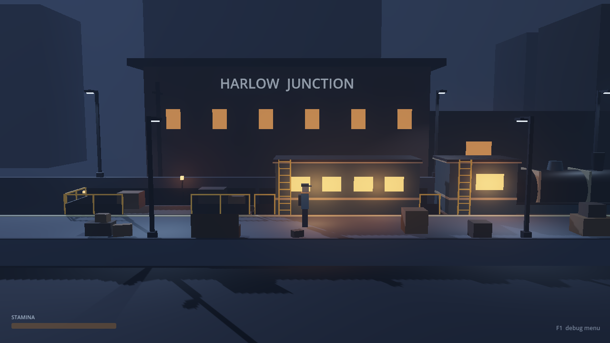
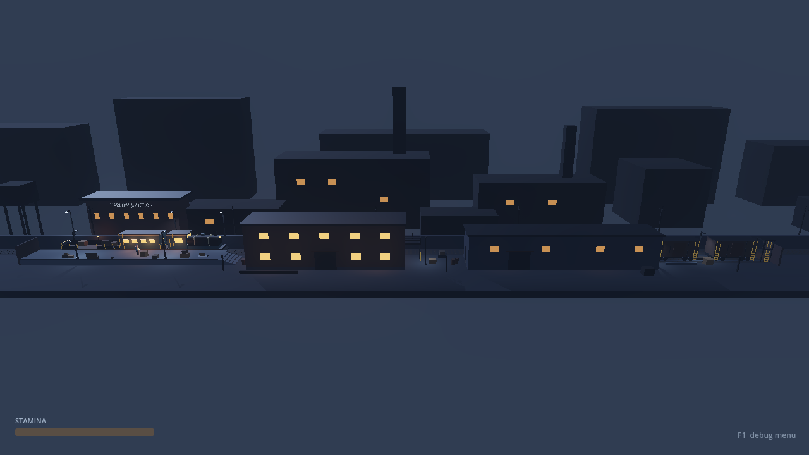
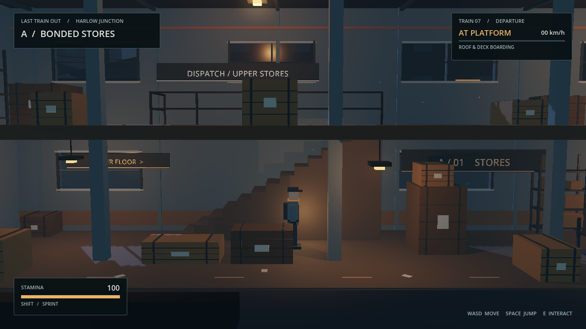
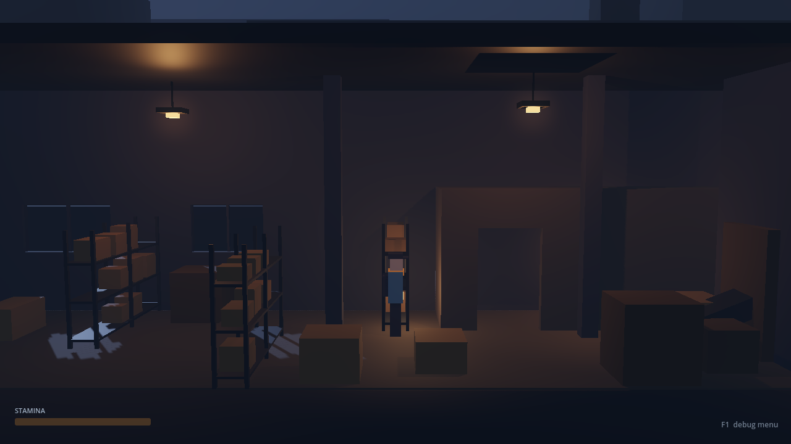
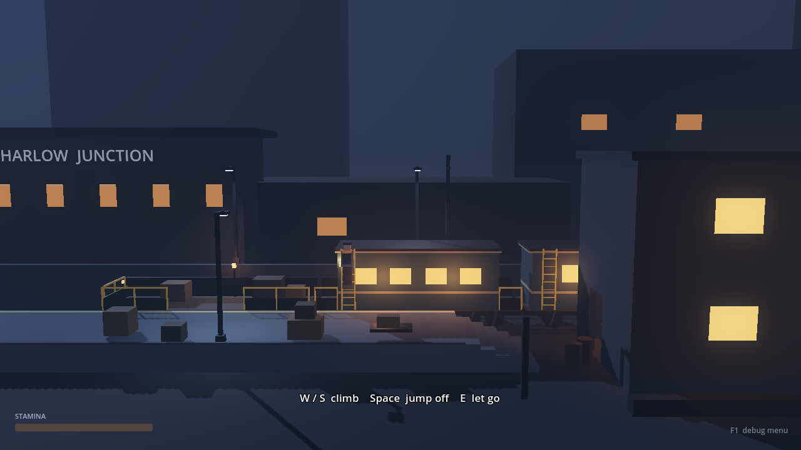
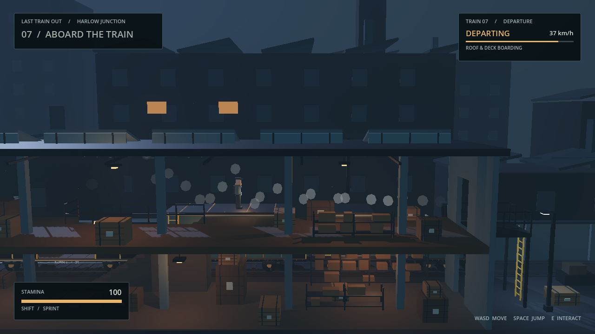
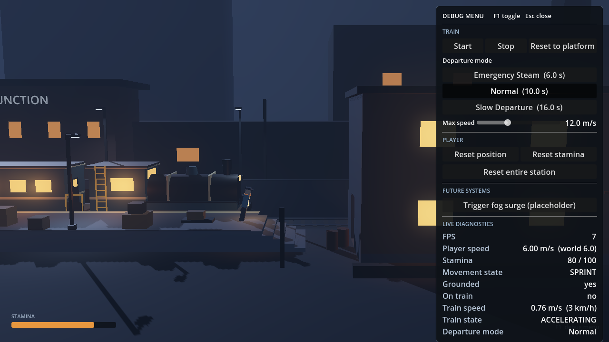

# Last Train Out

A survival game about the operator of the last working train in a city that is
being swallowed by fog. This repository holds **Milestone 1: a playable
gray-box prototype of the first station, Harlow Junction**, built with
**Godot 4 and GDScript** using only primitive meshes and built-in engine
features (no plugins, no imported art).

The milestone is about one thing above all: sprint along the platform, time a
jump, grab the moving train, climb aboard and ride away.



| | |
|---|---|
| Engine | Godot **4.5 or newer** (authored on 4.5.1, also verified on 4.7) |
| Language | GDScript |
| Renderer | Forward+ on desktop (Compatibility fallback configured for web) |
| Physics | Jolt Physics, 60 ticks/s, physics interpolation on |
| macOS app | Built automatically by GitHub Actions for Apple Silicon and Intel - [download and play](#play-on-macos-no-godot-needed) |
| Status | See [docs/TEST_REPORT.md](docs/TEST_REPORT.md) for what is verified and what is not |

---

## Play on macOS (no Godot needed)

Every push to the development branch is tested and built by GitHub Actions into a standalone
**Last Train Out.app**: one universal app for Apple Silicon and Intel Macs that contains the
Godot runtime and all game data. You do not need Godot, Xcode or anything else to play it.

### 1. Download the latest build

1. Open **[Actions → macOS app](https://github.com/oiwdis/last-train-out/actions/workflows/macos-app.yml?query=is%3Asuccess)**
   (the link lists successful runs only) and click the newest run.
2. At the bottom of the run page, under **Artifacts**, click
   **LastTrainOut-macos-universal.zip**. You need to be signed in to GitHub.

The run page also shows the build number, the commit it was built from and the ZIP's SHA-256.
Development builds are kept for 30 days.

### 2. Unzip and open it

1. Double-click **LastTrainOut-macos-universal.zip** in your Downloads folder (Safari may have
   unzipped it already). You get **Last Train Out.app**.
2. Move it wherever you like, for example to **Applications**.
3. Open it. A development build needs one extra step the first time - see below.

### 3. The macOS security warning (development builds)

Development builds are ad-hoc signed, not signed with a Developer ID and not notarized by
Apple. macOS marks anything downloaded from the internet as quarantined, and Gatekeeper refuses
to open a quarantined app it cannot trace to a known developer. Expect a message such as
*"Apple could not verify 'Last Train Out' is free of malware"* or *"cannot be opened because the
developer cannot be verified"*. That is what an un-notarized build looks like to macOS; it does
not mean the download is broken. Use either of these, once per downloaded build:

- **Terminal (quickest).** Remove the quarantine mark, then open the app normally:

  ```bash
  xattr -dr com.apple.quarantine "/Applications/Last Train Out.app"
  ```

  (Change the path if you put the app somewhere else.)

- **System Settings.** Try to open the app and dismiss the warning. Then open
  **System Settings → Privacy & Security**, scroll down to the message about *Last Train Out* and
  click **Open Anyway**, and confirm with your password or Touch ID. On macOS 14 and earlier you
  can instead Control-click the app, choose **Open**, then **Open** again.

If macOS says the app *"is damaged and can't be opened"*, it is the same quarantine block; the
Terminal command above clears it. Signed builds (below) open without any of this.

### 4. Replacing an older build

1. Quit the game if it is running.
2. Delete the old **Last Train Out.app** (or drag the new one to the same place and choose
   **Replace**).
3. Open the new one. Each download is quarantined afresh, so repeat step 3 above.

There is nothing to migrate: the prototype has no save files. To see which build an app is,
run:

```bash
defaults read "/Applications/Last Train Out.app/Contents/Info" LTOBuildNumber
```

The number is the run number shown on the Actions page (`LTOBuildCommit` holds the commit).
Godot writes its log to `~/Library/Application Support/Godot/app_userdata/Last Train Out/logs/`,
which is the place to look if the game does not start.

### What a build has been through

Each build is only uploaded after the workflow has:

1. run every automated test on macOS (the build fails if any test fails);
2. exported the app with Godot 4.5.1 and the matching official export template;
3. checked the bundle: executable for both architectures, `Info.plist`, the game data pack
   (every scene, script and resource of the project), a valid code signature;
4. launched the exported app on the runner, without and with its window, in a self-test that
   loads the real game, walks and jumps the player and rides the departing train;
5. checked that the ZIP holds the complete bundle, file for file.

Two more jobs then download the ZIP the way you would, unzip it and launch it again - one on an
Apple Silicon Mac, one on an Intel Mac. On Apple Silicon the app opens its window and renders
with Metal. GitHub's Intel Macs have no usable GPU, so there the Intel half of the app is only
run without a window: the game logic is checked on Intel, the picture is not.

This shows that the app starts and the game runs on GitHub's Macs. It does not replace a person
playing it: nobody sees the picture or feels the controls in CI, and GitHub's Macs are virtual
machines (their GPU cannot render the game's volumetric haze, so that effect is switched off
there and is only seen on a real Mac).

### Signed and notarized builds

The same workflow can also produce a build that is signed with a **Developer ID Application**
certificate, **notarized** by Apple and **stapled**, so it opens on any Mac without the warning
above. This is for distributing the game outside the Mac App Store. It only runs when you ask
for it, and it needs your Apple Developer credentials stored as encrypted repository secrets -
nothing secret is ever committed.

**Set up (once):** add these under **Settings → Secrets and variables → Actions**. They are the
same names TIDEBORN uses. Step-by-step instructions, including how to create each value, are in
[docs/macos-signing.md](docs/macos-signing.md).

| Secret | What it is |
|---|---|
| `MACOS_CERTIFICATE_P12_BASE64` | your Developer ID Application certificate and key (.p12), base64-encoded |
| `MACOS_CERTIFICATE_PASSWORD` | the password you chose when exporting the .p12 |
| `APPLE_API_KEY_P8_BASE64`, `APPLE_API_KEY_ID`, `APPLE_API_ISSUER_ID` | an App Store Connect API key for notarization (recommended) |
| `APPLE_ID`, `APPLE_APP_SPECIFIC_PASSWORD`, `APPLE_TEAM_ID` | alternative to the API key: your Apple ID with an app-specific password |

**Make a signed build:** open **Actions → macOS app → Run workflow**, pick the branch, tick
**Sign with Developer ID and notarize** and run it. When it finishes, download
**LastTrainOut-macos-universal-signed.zip** from the run's Artifacts.

If the secrets are missing, or Apple rejects the app, the signing job fails and says why; no
signed ZIP is produced, and the development build from the same run is unaffected.

---

## Develop with Godot

You only need this to change the game or run it from source. To just play, use the build above.

### 1. Install Godot

Download the standard (non-.NET) build of **Godot 4.5 or newer** from
<https://godotengine.org/download>. On macOS the universal build runs natively
on Apple Silicon and Intel; drag `Godot.app` into `/Applications`.

### 2. Open and run the project

1. Clone this repository.
2. Start Godot, choose **Import**, and select `project.godot` in the cloned folder.
3. Wait for the first import to finish (a few seconds), then press **F5**
   (or the Play button). The game launches straight into Harlow Junction.

From a terminal (macOS path shown; use `godot` if it is on your `PATH`):

```bash
/Applications/Godot.app/Contents/MacOS/Godot --path .
```

To open the isolated movement test scene instead of the station:

```bash
/Applications/Godot.app/Contents/MacOS/Godot --path . scenes/main/movement_sandbox.tscn
```

---

## Controls

| Input | Action |
|---|---|
| **A / D** (or ← / →) | Move left / right |
| **W / S** (or ↑ / ↓) | Move into / out of the scene; climb up / down on ladders |
| **Shift** | Sprint (drains stamina) |
| **Space** | Jump (hold for full height, tap for a short hop) |
| **E** | Contextual interaction: grab a ladder or railing, vault / climb an obstacle, let go |
| **F1** (or **`**) | Toggle the debug menu |
| **Esc** | Close the debug menu |

All actions are defined in the Input Map (**Project → Project Settings → Input
Map**) and can be rebound there. `` ` `` is a second binding for the debug menu
because F1 needs the Fn key on most MacBooks.

On a ladder: **W / S** climb, **Space** jumps off, **E** lets go.
On a railing: push toward it (**W** on the train) to climb over, **A / D** to
shimmy, **Space** to jump off, **E** to let go.

### Things to try

1. **Jump aboard.** Press **F1** and click **Start** (Normal departure). Sprint
   along the platform edge beside the flat car, then hold **W** and press
   **Space** to jump onto its open deck.
2. **Catch a ladder.** Click **Reset to platform**, choose **Emergency Steam**,
   stand at the platform edge ahead of one of the yellow ladders, press
   **Start**, and press **E** as the ladder passes. Hold **W** to climb to the
   roof and ride out of the station. A ladder moving much faster than you
   cannot be caught - run with the train first.
3. **Grab a railing.** The yellow rails on the flat car and the crew car's end
   decks can be grabbed from the platform or from the ground with **E**.
4. **Explore.** Warehouse A has stairs, an upper floor and a balcony ladder.
   Warehouse B's direct doorway is blocked - the back room leads around it.
   The freight yard has climbable cars and a gap to jump.

---

## Debug menu

Press **F1** (or `` ` ``). The game keeps running and movement keys keep
working while it is open.

- **Train:** Start, Stop, Reset to platform, departure mode
  (Emergency Steam 6 s / Normal 10 s / Slow Departure 16 s to full speed),
  maximum speed slider.
- **Player:** Reset position, Reset stamina, Reset entire station.
- **Future systems:** Trigger fog surge (prints a message; placeholder only).
- **Live diagnostics:** FPS, player speed, stamina, movement state, grounded,
  on train, train speed, train state, departure mode.

---

## Project structure

```text
last-train-out/
├── project.godot
├── export_presets.cfg   macOS export preset (universal app, ad-hoc signed, no credentials)
├── .github/workflows/   macos-app.yml - tests, builds, checks and uploads the macOS app
├── scenes/
│   ├── main/            main.tscn (the game), movement_sandbox.tscn (isolated test scene),
│   │                    self_test.tscn (what an exported build runs to test itself in CI)
│   ├── station/         harlow_junction.tscn
│   ├── buildings/       warehouse_a.tscn, warehouse_b.tscn
│   ├── train/           train.tscn, locomotive.tscn, crew_car.tscn, flat_car.tscn
│   ├── player/          player.tscn
│   ├── props/           station_lamp, hanging_lamp, freight_car
│   └── ui/              hud.tscn, debug/debug_menu.tscn
├── scripts/
│   ├── player/          player, input, stamina, interactor, movement config
│   ├── train/           train, train_car, departure_mode
│   ├── camera/          camera_rig, camera_zone, camera_profile
│   ├── interaction/     interactable (base), ladder, grab_rail
│   ├── environment/     gray-box blocks, stairs, racks, track, cutaway walls, station
│   ├── main/            game.gd - wires the systems together
│   └── ui/              debug_menu, hud
├── systems/             fog_system, passenger_system, inventory_system (placeholders)
├── resources/           tunable data: movement, departure modes, camera profiles, materials
├── tests/               test runner, unit and integration tests
├── tools/               run_tests.sh, screenshot capture, demo recording
│   └── macos/           build scripts used by the workflow (install Godot, export, verify, self-test)
└── docs/                architecture notes, test report, signing guide, screenshots, recording
```

### Where to tune things

| What | Where |
|---|---|
| Walk / sprint speed, jump, coyote time, buffering, climbing, vaulting | `resources/player/default_movement.tres` |
| Stamina drain / regeneration | `Stamina` node in `scenes/player/player.tscn` |
| Departure modes (time to full speed, optional curve) | `resources/train/departure_*.tres` |
| Train maximum speed, braking, track length | `Train` node in `scenes/train/train.tscn` |
| Camera framings (outdoor, indoor, train departure) | `resources/camera/*.tres` |
| Haze, moonlight, glow | `Atmosphere` in `scenes/station/harlow_junction.tscn` |

### Architecture in brief

- **Player** (`CharacterBody3D`) has three movement modes: normal
  `move_and_slide` locomotion, *attached* (ladder / railing, positioned in the
  anchor's local space) and *scripted* (vault, mantle, mounting). The player is
  never parented to the train.
- **Train** integrates speed and distance on the physics tick and moves each
  car, a kinematic `AnimatableBody3D` with `sync_to_physics`, so Godot's own
  moving-platform velocity inheritance carries the rider.
- **Interaction** is extensible: anything derived from `Interactable` is found
  by a shape query; vaulting works on any geometry via raycasts.
- **Camera** blends between `CameraProfile` resources requested by
  `CameraZone` volumes and by the game (train departure). It only ever knows a
  target node.
- **Cutaway walls** fade when a `CutawayTrigger` volume holds the player -
  inside a building, or passing behind it on the train.
- **Game** (`scripts/main/game.gd`) is the only script that knows about all of
  the above; everything else talks through signals and exported references.
- **Fog, passengers and inventory** are small scene-owned placeholder nodes
  with their final signal names. They are not autoloads.

More detail, including the reasoning behind the moving-platform approach, is
in [docs/ARCHITECTURE.md](docs/ARCHITECTURE.md).

---

## Tests

The project has a small Godot-native test runner (no add-ons). Tests drive the
real player through a scripted-input hook and run the real physics.

```bash
tools/run_tests.sh /Applications/Godot.app/Contents/MacOS/Godot
```

That script imports the project, runs the main scene headless for 600 frames
and then runs every test. To run the tests alone:

```bash
/Applications/Godot.app/Contents/MacOS/Godot --headless --path . --import
```

```bash
/Applications/Godot.app/Contents/MacOS/Godot --headless --path . --fixed-fps 60 tests/test_runner.tscn
```

Add `-- --only=<text>` to run only the test files whose name contains
`<text>` (for example `-- --only=moving_platform`). The first command is needed
once after cloning (and after adding scripts) so Godot knows the script
classes.

The same script runs on macOS in GitHub Actions before every build; the app is only exported
when it passes.

What is covered, the measured numbers and - just as important - what could
**not** be verified are listed in [docs/TEST_REPORT.md](docs/TEST_REPORT.md).

### Building the app yourself (optional)

GitHub Actions does this for you. On a Mac with nothing installed, the same scripts work:

```bash
tools/macos/install_godot.sh
```

```bash
tools/macos/export_app.sh ~/godot-ci/Godot.app/Contents/MacOS/Godot
```

The first downloads Godot 4.5.1 and its macOS export template into `~/godot-ci` (checksums are
verified); the second writes `build/macos/Last Train Out.app`.

---

## Screenshots and recording

The files in `docs/screenshots/` and `docs/recording/` were rendered from the
running game by `tools/capture_screenshots.tscn` and `tools/record_demo.tscn`;
the player in them is driven by scripted input. See the test report for how
they were produced.

| | |
|---|---|
|  |  |
| Harlow Junction, platform to freight yard | Warehouse A, ground floor (front wall cut away) |
|  |  |
| Warehouse B, main hall | Climbing the ladder of the departing train |
|  |  |
| Riding the roof behind Warehouse A | Debug menu |

---

## Scope

Milestone 1 deliberately stops at the gray-box: there is no advancing fog,
passenger AI, inventory, train upgrades, route selection, dialogue, audio,
menus or saving. Those arrive in later milestones.
