# Milestone 3.5 integrated visual review

Native captures from the build identified in the [evidence provenance](validation/milestone35/native-final/README.md). The [full journey video](recording/milestone35-full-journey.mp4) is one continuous fixed-rate engine recording, including the real Save/Continue reload and mission results. Its 12 FPS capture rate is not a performance measurement.

The first group comes from the controls-driven journey. The second uses deliberately positioned rendering fixtures; their HUD objective/train state is not evidence of mission progression. Benchmark screenshots retain the actual Low/Medium/High rendering settings and are not retouched.

## Actual journey

The detailed survivor, locomotive and Harlow architecture coexist with the survival HUD and searchable supplies. Character faces and repeated surfaces remain below a photorealistic reference.

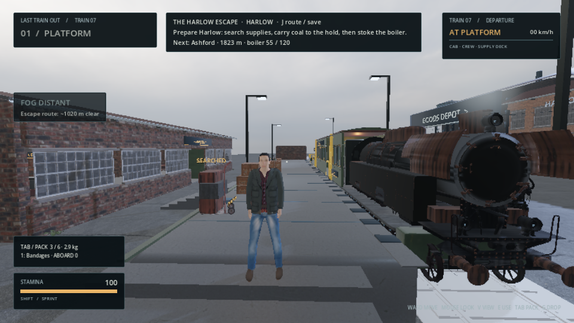

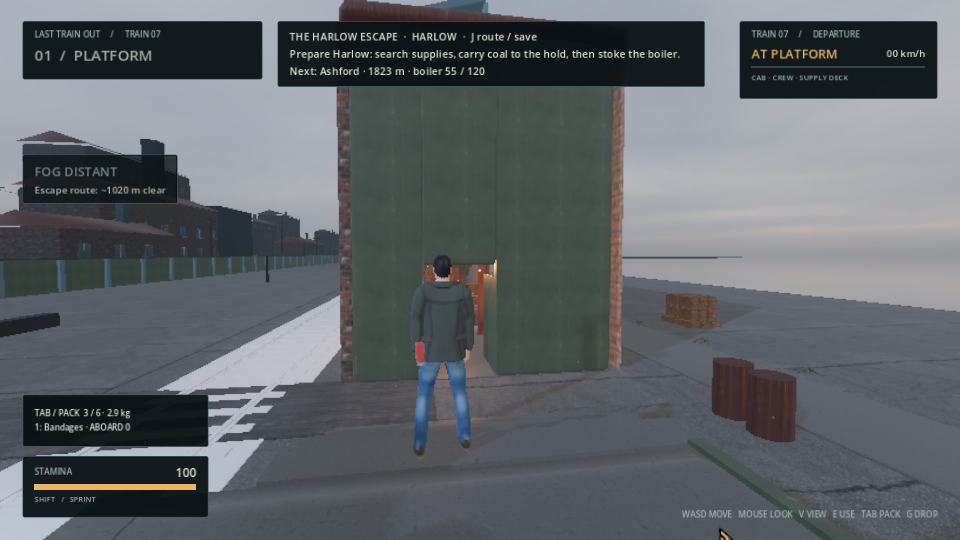

Carrying uses the real inventory/cargo owner and character pose. Workshop salvage can be abandoned with G as fog closes, before returning to refuel.

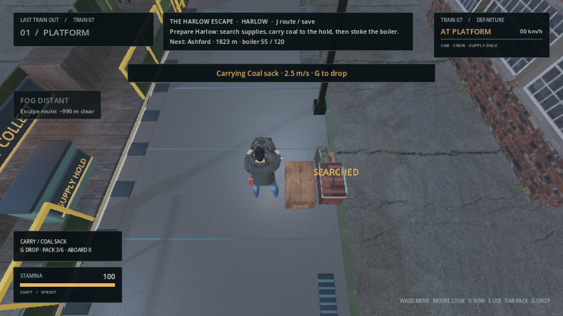

The matching first-person arms hold the real coal sack. Interaction labels remain oversized when viewed very closely; this is a remaining presentation issue.

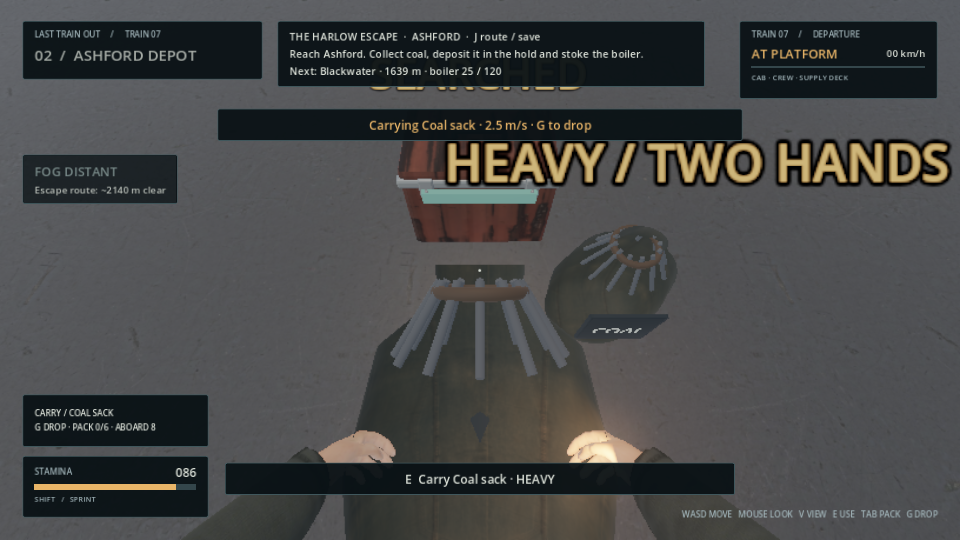

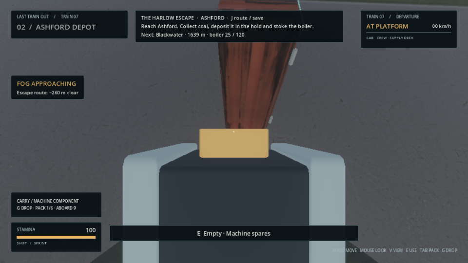

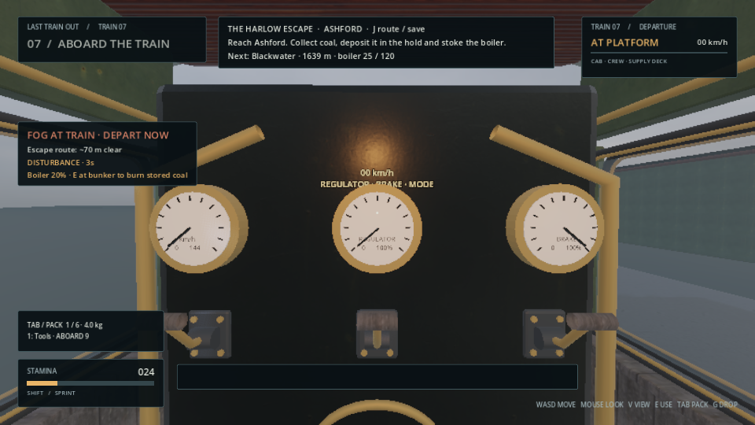

These frames show the actual saved world and resumed Blackwater cab. The validation compares the full saved snapshot, route progress, expected station, player position/support, camera, supplies, note and cargo count.

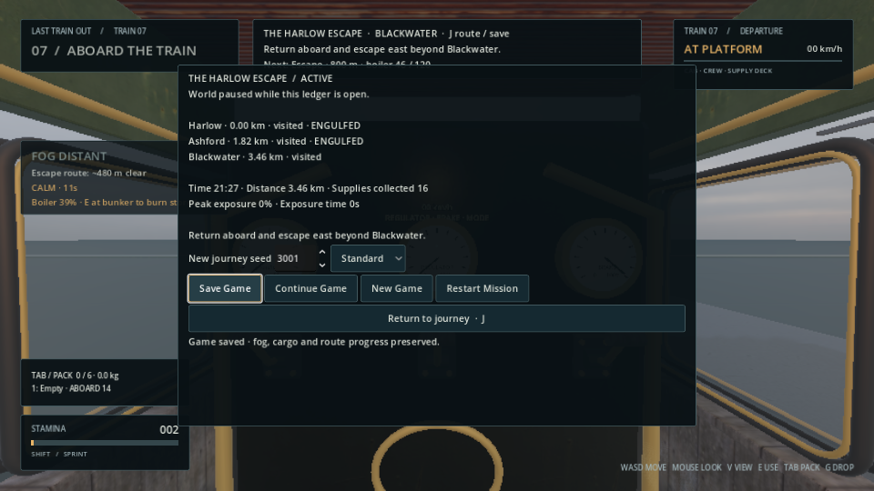

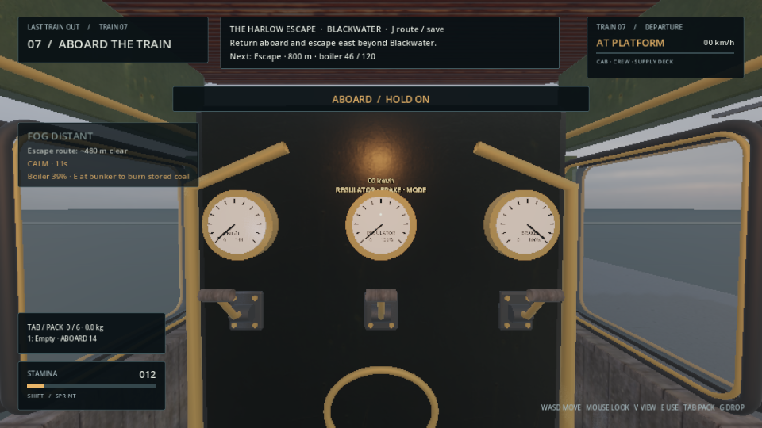

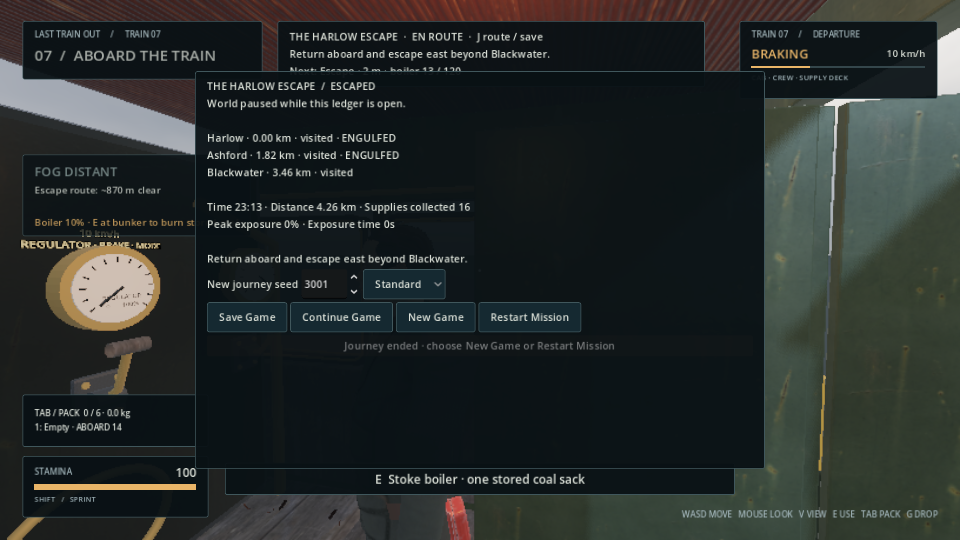

## Rendering fixtures

The cab eye hides the third-person body using the gameplay visibility rule. The curved-track fixture runs real train and rider physics. Wheel/rail geometry is also checked at straight, curved and elevated route positions by the integration suite.

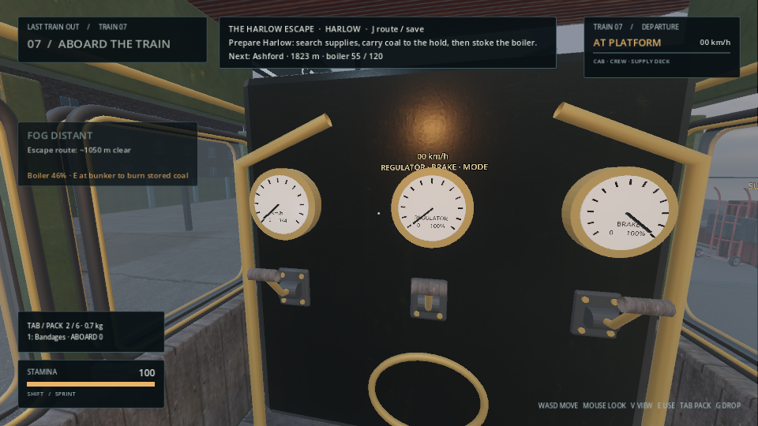

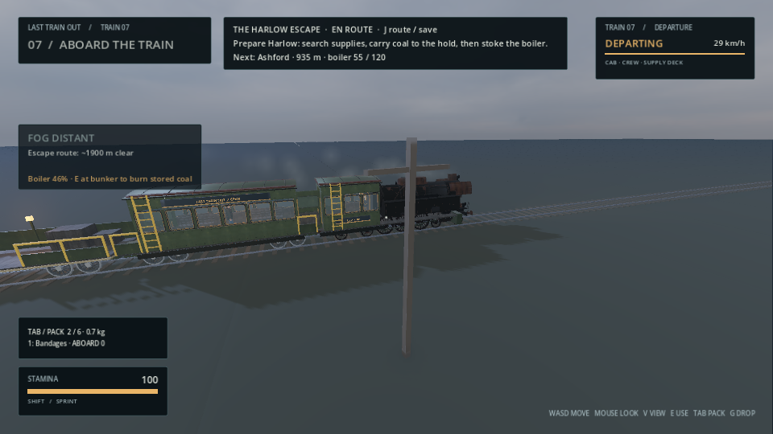

Harlow retains its detailed warehouses, materials and props. Ashford and Blackwater reuse that material/prop system on simpler modular shells; sparse terrain, large plain floors/walls and repeated detail remain visible. The route and added stations are not fully photorealistic.

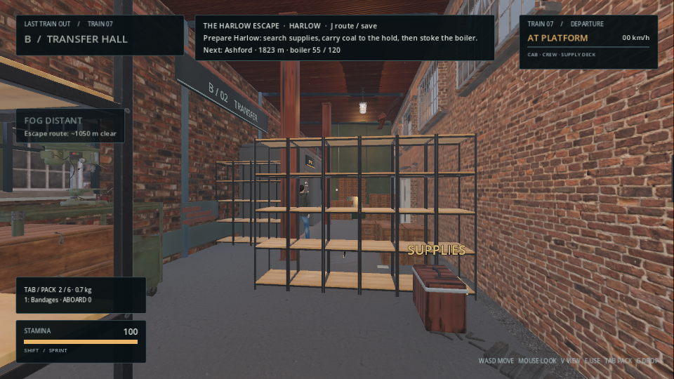

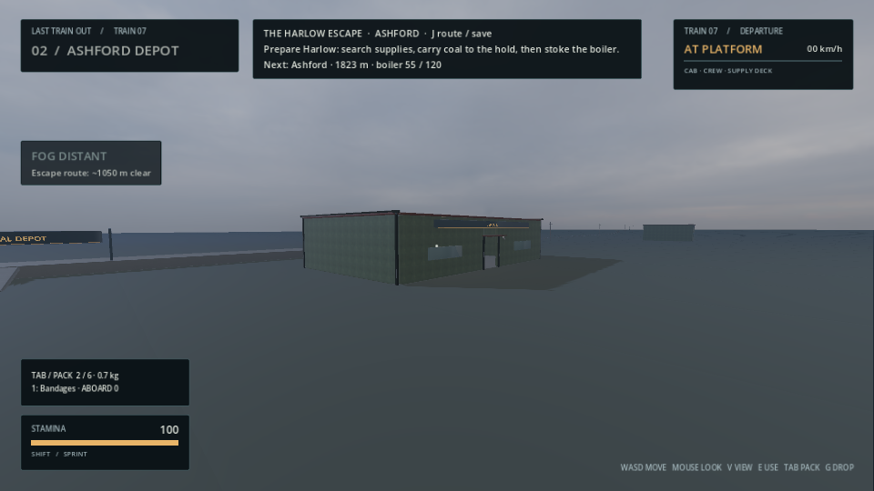

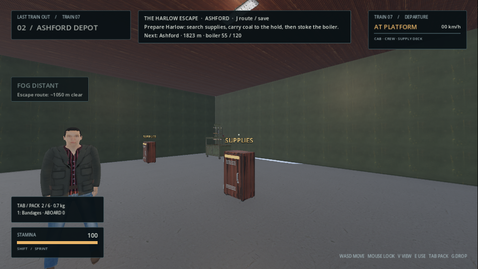

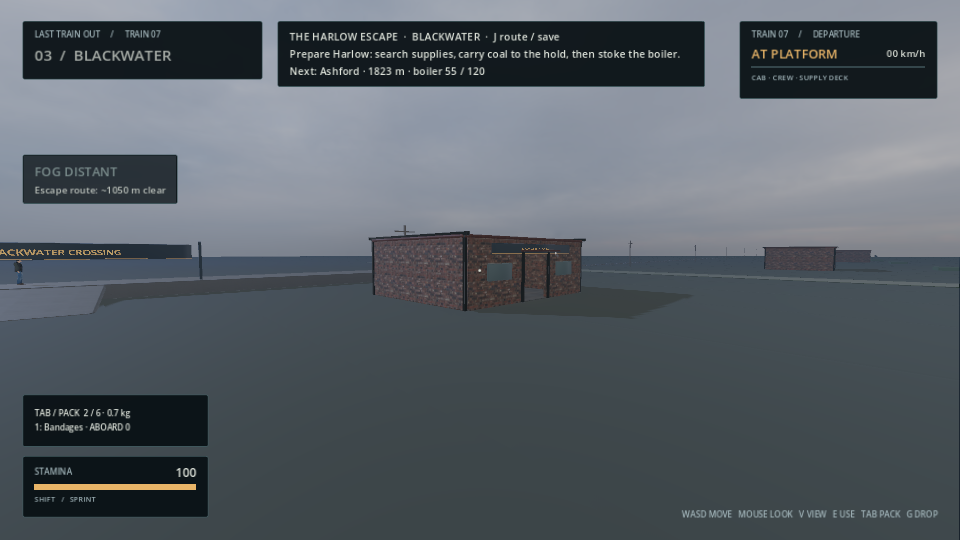

The approaching front and observer haze remain readable beside PBR surfaces. Low's reduced internal resolution makes edges and cutaways visibly coarse; the fog remains a layered approximation, not a volumetric simulation. Refer to the [performance report](PERFORMANCE_MILESTONE35.md) for the cost and frame-time tails.

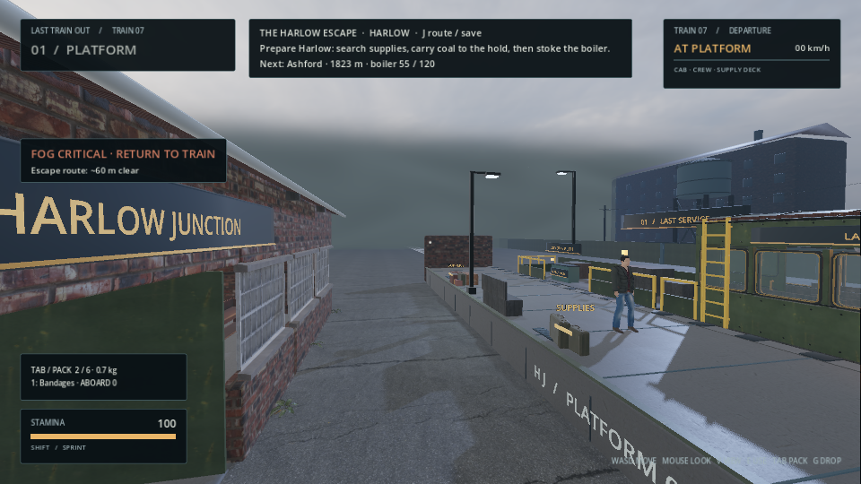

| Low inside fog | Medium inside fog | High inside fog |
|---|---|---|
| 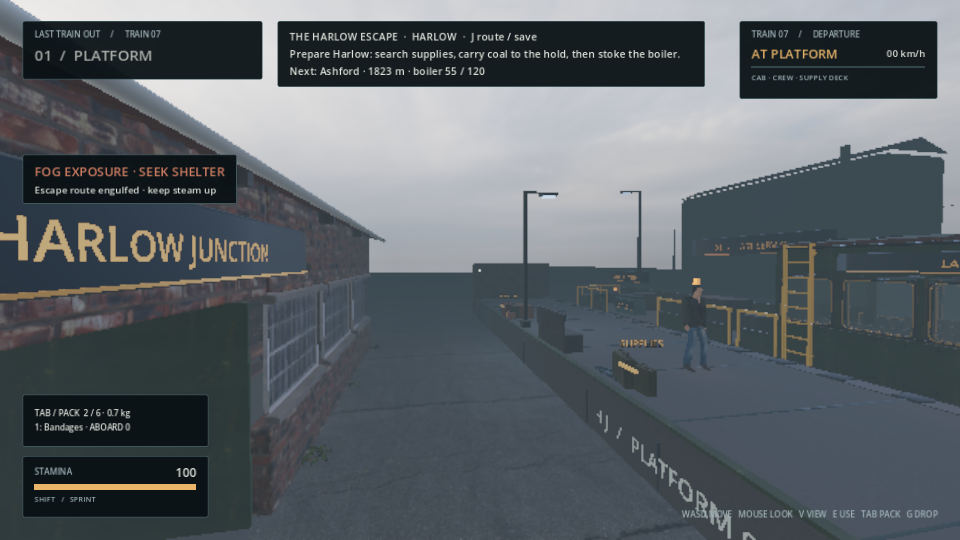 | 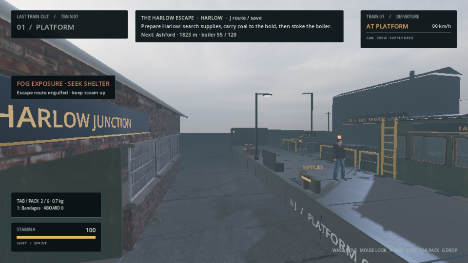 | 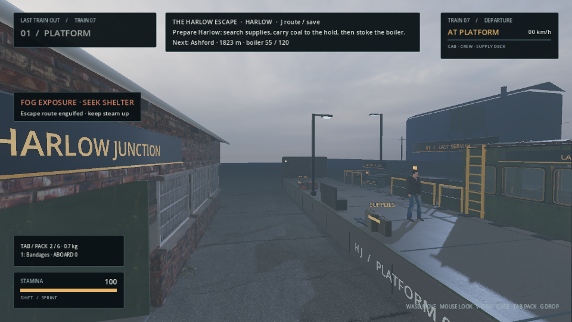 |

The evidence directory contains every required location in all three presets. These images show a cohesive playable art/gameplay integration with remaining visual limitations; they do not establish full photorealism or physical-M1 performance.
