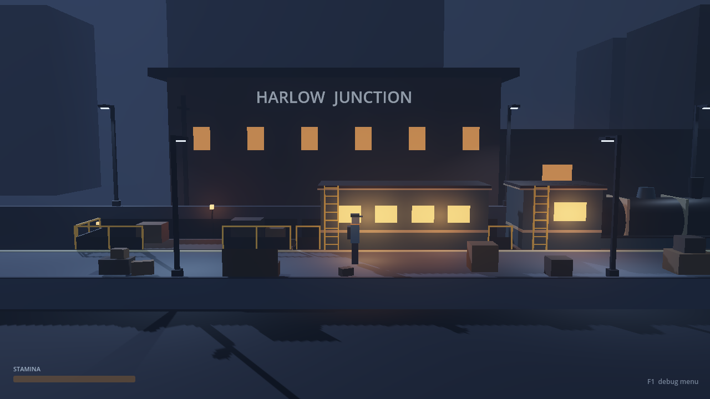
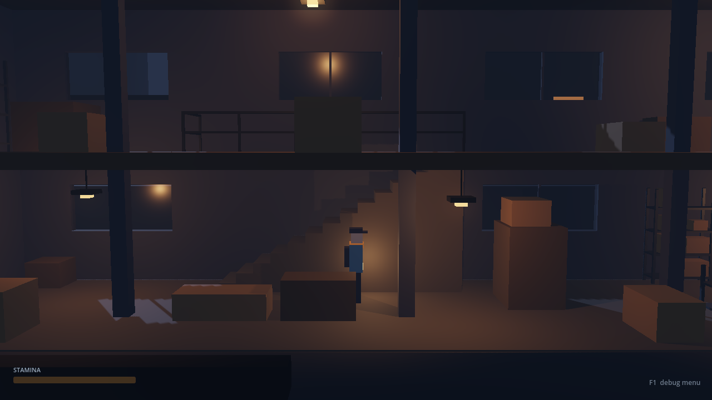
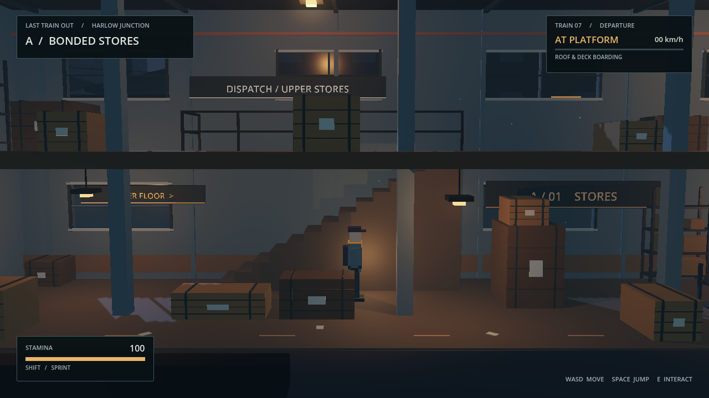
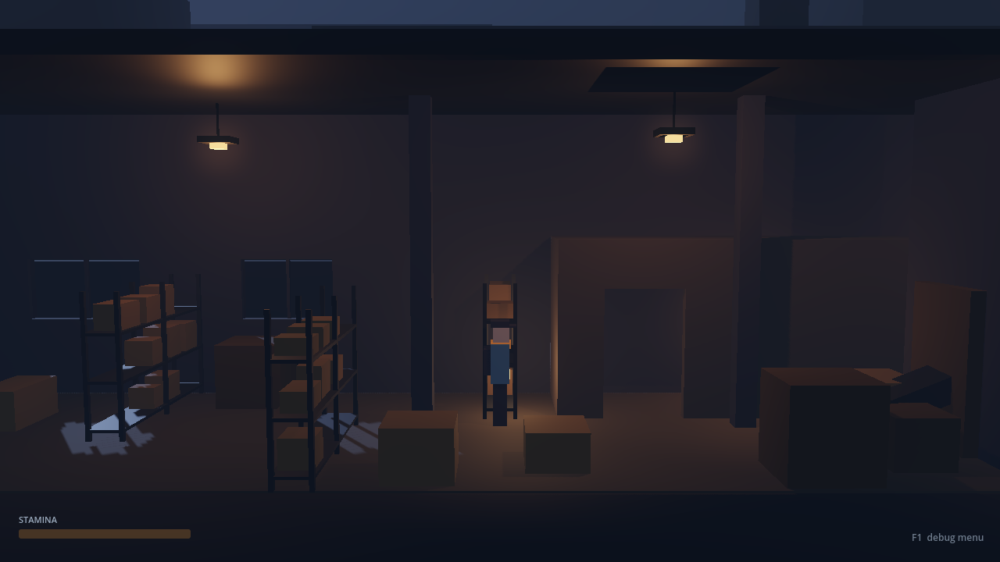
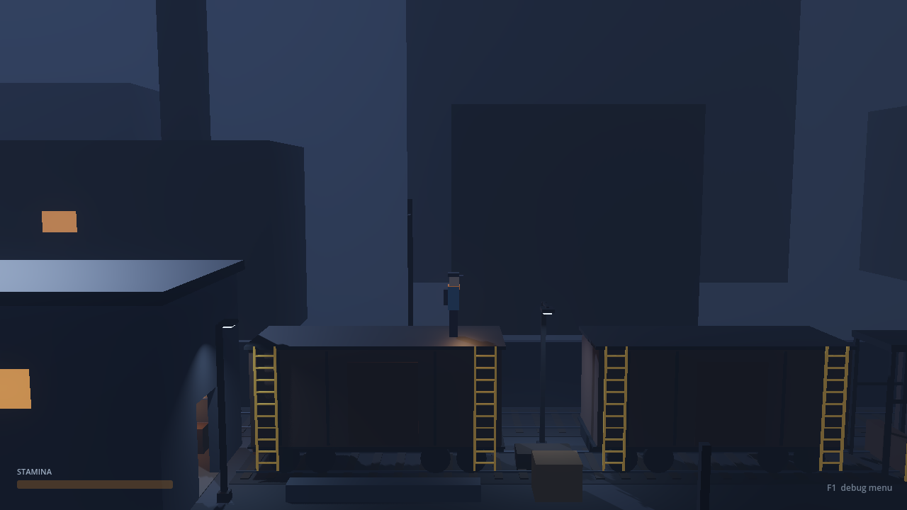
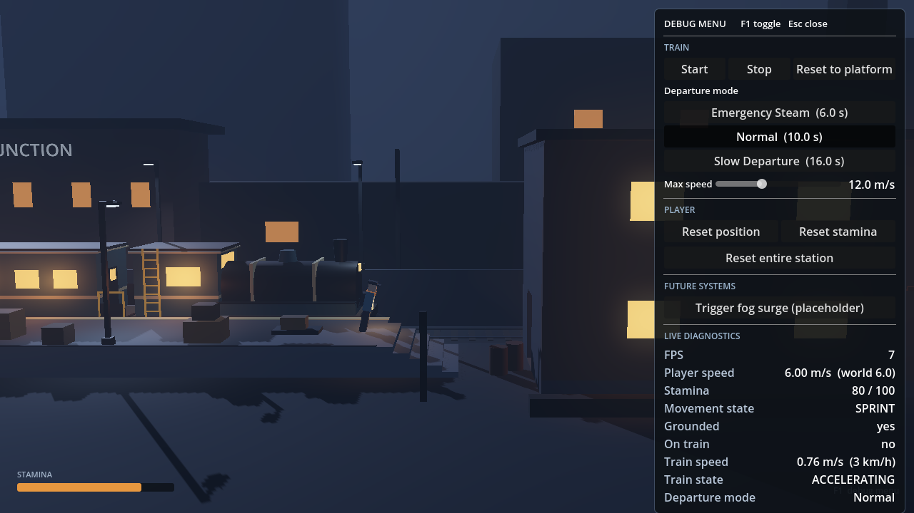

# Milestone 1.5 — Harlow after the last service

The train is the warm, inhabited object in a cold industrial station. Amber is used for
train windows, handholds, useful signs and the stamina instrument. The exterior uses
slate, oxidised steel and desaturated masonry. Warehouse A is a brick bonded store with
evacuation notices and dispatch signage; Warehouse B is a transfer hall with a closed
main aisle and a marked service detour. The freight exchange has corrugated cars and a
crane silhouette. The station clock, suspended-service board and abandoned luggage
establish a place that was operating until recently.

## What changed

- Train: framed windows, curtains and sashes, enamel name and number plates, panel seams,
  rivets, boiler bands, pipework, chimney rim, wheel hubs and speed-responsive steam.
- Platform: edge warnings, expansion joints, drainage grates, retaining-wall piers,
  luggage, station nameplate, clock and layered industrial skyline with roof forms,
  windows, water-tower bracing and sagging utility cables.
- Warehouses: mullions, facade ribs/courses, structural trim, sawtooth skylights, roof
  trusses, signs, exposed brick, broken conduit, maintenance panels, worn aisle paint
  and sparse paper. Existing crates gain boards, straps and labels.
- HUD: consistent railway instrument panels for location, live train status/speed,
  eased stamina with an explicit exhaustion warning, contextual interaction hints,
  boarding confirmation and fading notices. No countdown is invented: departure is
  still started with the developer controls in this milestone.
- Player: separate legs and arms with walk, sprint, climb, hang and vault poses; restrained
  landing compression and jump/landing dust. Ambient motes add movement to the station.
- Developer console: numbered sections, matching control styling, live telemetry and
  scrolling at shorter window heights. All original actions remain available.

## Implementation and budgets

`DetailBuilder` combines boxes and braces by material into ordinary `MeshInstance3D`
batches. A building's front and back details have separate parents under their original
`CutawayWall`, so the existing material fade and visibility logic applies to trim and text.
Signs use `TextMesh` rather than labels that would remain visible after the wall disappears.
Materials are standard Godot materials; no custom shader, plugin, paid asset, font download,
reflection probe, screen-space effect or additional shadow-casting light is required.

The art pass uses about 200 decorative mesh instances (the exact count is logged by the
presentation tests), 42 ambient CPU particles, 10 one-shot dust particles and 22 steam
particles. Static details are built once per scene instance. Shadows continue to come from
existing solid geometry; detail meshes do not add shadow passes. This is a bounded budget,
not a claim of 60 FPS. Profile on a real MacBook Air before making a performance promise.

`PresentationEffects` observes player signals and states. It never writes player velocity,
collision shapes, movement configuration, train physics or the follow camera. The existing
camera's profile easing, departure widening and building cutaways remain in place. There
is no camera shake. The unsupported-volumetric-fog capability check is unchanged.

## Gameplay and limitations

No gameplay tuning or collision layout changes were made. The train's interiors remain
visual suggestions behind windows; the playable boarding surfaces are roofs, decks,
ladders and railings. The fog surge, inventory and passengers remain placeholders.

HUD location names describe the authored Harlow bounds. A future station should provide
its own named zones rather than reuse those coordinates. The procedural art builders are
runtime children; run the scene to preview them (the underlying collision/layout scenes
remain editable in the Godot editor).

## Evidence

The original ten screenshots are preserved in `screenshots/before/`; updated captures use
the same camera placements and scripted routes. The overview alone uses a detached camera
and thinner fog, as it did in Milestone 1. See [TEST_REPORT.md](TEST_REPORT.md) for exact
verification, capture methods and current limitations.

[Watch the 59-second gameplay tour](recording/milestone1_5_demo.mp4).

| Area | Before | After |
|---|---|---|
| Train and platform |  |  |
| Warehouse A |  |  |
| Warehouse B |  |  |
| Freight exchange |  |  |
| Developer console |  |  |
