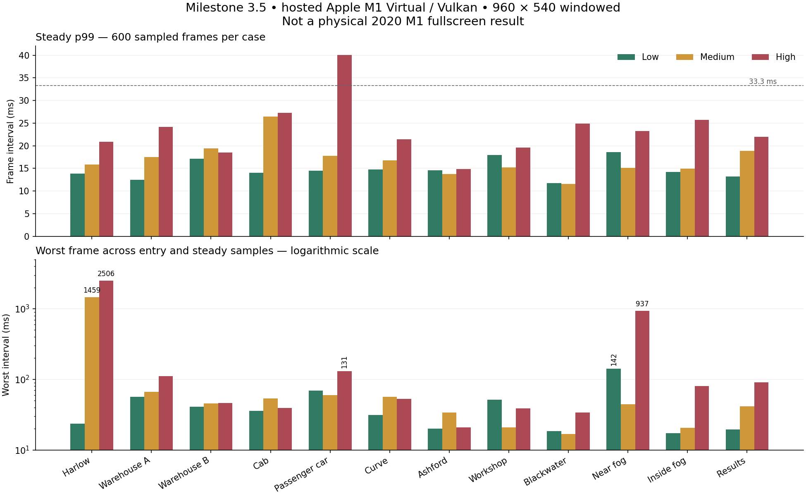

# Milestone 3.5 rendering performance

The final runtime cohort is [run 46](https://github.com/oiwdis/last-train-out/actions/runs/44460966340), source `45c3b338a694f587b5290af0e8ce19208d0a702e`. All requested locations/presets and source comparisons are measured. **Performance acceptance remains open:** this cohort contains a 2.51 s entry stall and a 0.94 s near-fog steady-sampling outlier. Physical 2020 M1 fullscreen performance is unverified. The earlier run 44 data remain below to show variability rather than replacing an unfavorable result.

## Measurement method

`tools/macos/benchmark_integration.py` runs four sequential processes on the same hosted Apple Silicon runner: the integrated twelve-location matrix, integrated fog/animation ablations, and matched Harlow views from the exact PR #4 and PR #5 source heads. Godot 4.5.1 runs at 960×540 windowed with V-sync and the frame cap disabled. There is no fixed timestep, Movie Maker or competing render job during timing. Each view retains its first 60 entry frames, then warms for 120 frames and samples 600 steady frames. Raw frame intervals, mean, p50/p95/p99 and worst time remain in the JSON.

The required matrix covers Harlow platform, both warehouses, locomotive cab, passenger car, a moving curved railway section, Ashford Depot and workshop, Blackwater, near and inside danger fog, and the results screen, in Low/Medium/High. These are deliberately positioned rendering fixtures; they do not prove mission progression. Survival progression is held fixed for comparable danger states, and most cases freeze settled player/train physics; the curved-track case runs real train and rider physics. Thus these are rendering and idle/moving-view CPU measurements, not an isolated measurement of survival-authority CPU cost. The independently recorded controls-driven journey supplies gameplay evidence. Curve placement waits for physics synchronization before reading car positions and updates the surrounding route visibility. Static fixtures establish real floor/car support before freezing physics, while the measurement camera remains at the previous view. Cab and passenger views use the normal first-person body-visibility rule; the other views retain the full worker. The new-station views face the occupied yards and entrances, including props and signs.

Scene construction and destination-GPU preparation, and each preset's preparation, are reported separately. The benchmark loading counters begin after its script bootstrap; exported self-test timestamps separately capture process-to-mission-ready latency, including that earlier work. Export and app launch precede these source-project benchmarks, so the runs are cache-conditioned, not cold-start measurements. Pipeline counter deltas identify first-use work during each sampled view; zero steady compilation does not mean preparation was free.

CPU process/physics counters are periodically refreshed engine snapshots and may retain earlier work. Viewport CPU time measures render submission, not total frame CPU cost. Frame intervals are the end-to-end pacing measure. A zero GPU-time counter means unavailable. Texture/static memory is not total process memory; the wrapper separately samples resident memory every 0.5 seconds and retains those samples and the observed peak.

The five source comparison views share camera coordinates, field of view, resolution and sampling. Each source retains its actual art, graphics presets, renderer and worker settings. PR #4 and the integration use Vulkan/MoltenVK; PR #5 retains its original backend. This compares complete builds, not an isolated optimization or equal visual workload.

Ablations repeat the same Harlow/fog views with idle worker animation disabled, then with the danger sheets and observer haze disabled. They restore each feature before the next case. Animation removal can also permit shadow-map reuse, so its timing difference is not isolated skeleton CPU cost. Small one-run differences are subject to host and ordering variability. None of these diagnostic omissions changes shipped presets or fog simulation.

## Target hardware

The physical target is a 2020 M1 Mac in fullscreen, with a Low goal of 30+ FPS. Hosted Apple Silicon and software-rendered Linux do not establish this target. Follow the [repeatable physical-M1 procedure](M1_MILESTONE35.md), retain p99 and worst entry frames alongside averages, and record actual display size, internal render scale, power and thermal conditions.

The separate fresh-download diagnostic in run 46 attempt 1 hit a Vulkan/MoltenVK GPU timeout and device loss during High preparation. The windowed gameplay self-test had passed. Retrying the identical ZIP on a fresh runner passed all gameplay checks and 81 diagnostic cases; [both attempts are retained](validation/milestone35/native-final/README.md). This does not prove the device-loss cause or a fix. Those short 24-frame availability checks are separate from the full cohort below.

## Final runtime cohort: run 46

Hosted macOS 26.7.2, three virtual CPUs, Apple M1 (Virtual) / Apple Paravirtual device, **960×540 windowed**. Integration and PR #4 use Vulkan/MoltenVK; PR #5 uses Metal. All GPU timing readings are unavailable. [Raw reports and RSS samples](validation/milestone35/native-final/performance/) · [all-location CSV](validation/milestone35/native-final/performance/all-locations.csv) · [source comparison CSV](validation/milestone35/native-final/performance/source-comparison.csv).

Each cell is **mean FPS / p99 ms / worst steady ms**. These are rendering fixtures, with the sampling and frozen-survival scope described above.

| Location | Low | Medium | High |
|---|---:|---:|---:|
| Harlow platform | 119.6 / 13.84 / 23.74 | 89.3 / 15.90 / 18.00 | 72.5 / 20.84 / 36.14 |
| Warehouse A | 105.6 / 12.45 / 16.42 | 82.0 / 17.50 / 24.04 | 60.3 / 24.19 / 32.06 |
| Warehouse B | 113.5 / 17.17 / 40.73 | 83.7 / 19.42 / 45.83 | 68.2 / 18.49 / 20.48 |
| Locomotive cab | 96.1 / 14.05 / 16.02 | 71.0 / 26.48 / 54.01 | 58.0 / 27.27 / 39.47 |
| Passenger car | 93.8 / 14.45 / 18.27 | 76.2 / 17.82 / 21.95 | 52.1 / 40.09 / 58.59 |
| Curved railway | 133.2 / 14.80 / 19.82 | 103.4 / 16.78 / 23.53 | 79.3 / 21.45 / 33.57 |
| Ashford Depot | 127.0 / 14.57 / 20.00 | 120.7 / 13.72 / 34.06 | 94.5 / 14.81 / 20.88 |
| Ashford workshop | 116.8 / 17.95 / 51.42 | 109.0 / 15.21 / 20.80 | 84.8 / 19.62 / 39.07 |
| Blackwater Crossing | 141.8 / 11.79 / 18.52 | 125.0 / 11.61 / 16.91 | 88.7 / 24.88 / 34.05 |
| Near advancing fog | 118.0 / 18.56 / 22.30 | 96.7 / 15.12 / 21.33 | 65.9 / 23.23 / 937.36 |
| Inside dangerous fog | 127.2 / 14.19 / 17.41 | 97.2 / 14.93 / 20.63 | 70.1 / 25.75 / 80.89 |
| Mission completion | 138.8 / 13.22 / 15.77 | 111.1 / 18.88 / 41.34 | 77.8 / 21.95 / 90.62 |

The Harlow transition after changing presets still stalls: **1,458.95 ms Medium / 2,506.13 ms High** in the entry window. High near-fog sampling also contains a **937.36 ms** frame at sample 209 of its steady window; its p99 is only 23.23 ms, demonstrating why a percentile alone hides an isolated freeze. All three windows have zero draw/surface/specialization counter deltas. Their exact cause is unresolved; zero counter deltas do not prove that driver or prior asynchronous work was absent. The independent High inside-fog case reaches 80.89 ms worst; High passenger-car p99 reaches 40.09 ms. Low near-fog entry reaches 141.64 ms. **No claim of eliminated stutter is made.**

High Warehouse A entry has seven specialization compilations and a 110.64 ms worst frame. All 36 steady cases have zero pipeline-counter deltas. The two exact source builds also stall on High Harlow entry (PR #4 1,403.80 ms, PR #5 974.85 ms), with specialization deltas of 14 and 2 respectively; these observations do not establish a shared cause with the integration.

### Final source comparison

| Preset | PR #4 Warehouse B mean ms | Integration mean ms | Change vs #4 | PR #5 mean ms | Change vs #5 |
|---|---:|---:|---:|---:|---:|
| Low | 8.06 | 8.81 | +9.3% | 8.03 | +9.8% |
| Medium | 11.61 | 11.95 | +2.9% | 7.42 | +60.9% |
| High | 14.50 | 14.67 | +1.1% | 12.20 | +20.2% |

The earlier cohort's small Warehouse B mean improvement does **not** reproduce here. Low p99 worsens versus PR #4 from 12.03 to 17.17 ms, while Medium/High p99 improve from 20.46/23.24 to 19.42/18.49 ms. Elsewhere, Medium Warehouse A mean is 19.6% slower than PR #4; High cab/passenger means are 17.7%/15.7% slower. Against PR #5, High cab/passenger means are 75.5%/69.2% slower. The complete CSV retains every comparison. Different art/backends and host/order variability prevent calling these isolated optimization effects, but the observed regressions remain acceptance concerns.

### Final loading, CPU and memory

| Build | Scene construction | Rendering ready | Peak sampled RSS |
|---|---:|---:|---:|
| Integration | 12.07 s | 25.32 s | 577.6 MiB |
| PR #4 | 9.99 s | 24.08 s | 541.5 MiB |
| PR #5 | 18.48 s | 35.15 s | 656.9 MiB |

These source-project counters exclude earlier script bootstrap and are cache-conditioned. The **exported app** reaches mission readiness in **78.60 s from process start**, including 29.48 s of initial render preparation, and completes its entire windowed self-test at 136.86 s. Previous attempts reached mission readiness at 82.14 and 94.50 s. This remains long startup, even though the expanded bounded self-test now completes.

The matrix's subsequent Low/Medium/High preparation takes 0.26 / 4.67 / 8.66 s. Texture memory remains approximately 289.9 / 304.6 / 360.4 MiB; ablation peak RSS is 541.7 MiB. Steady render-submission CPU and draw ranges are:

| Preset | Viewport render CPU ms | Draw calls |
|---|---:|---:|
| Low | 0.51–0.91 | 123–629 |
| Medium | 0.61–1.32 | 168–1108 |
| High | 0.74–1.76 | 178–1176 |

Process/physics snapshots are retained in the CSV with their sampling limitations; they must not be summed with render time or subtracted from frame intervals to invent GPU timings.

### Final ablations

Mean ms in **normal / animation frozen / danger visuals off** order. Animation is restored before the danger comparison; shadow-map reuse and ordering noise remain confounders.

| View | Low | Medium | High |
|---|---:|---:|---:|
| Harlow platform | 9.07 / 8.51 / 8.87 | 12.44 / 11.94 / 11.90 | 12.92 / 12.16 / 15.58 |
| Near advancing fog | 9.10 / 7.84 / 10.66 | 10.15 / 12.76 / 10.71 | 12.36 / 12.36 / 12.72 |
| Inside dangerous fog | 8.55 / 8.11 / 8.13 | 11.45 / 10.22 / 10.45 | 17.62 / 10.40 / 10.17 |

High inside-fog reductions are 7.22 ms with animation frozen and 7.45 ms with danger visuals off in this sequence, much larger than run 44. Other deltas reverse sign or are small. These short ordered ablations therefore indicate workload sensitivity, not a stable isolated cost or an optimization claim. Shipped features remain enabled.

## Earlier cohort: run 44

macOS 26.7.2, arm64, three virtual CPUs, Apple M1 (Virtual) / Apple Paravirtual device. This is **960×540 windowed**, not a physical M1. Integration and PR #4 use Vulkan/MoltenVK; PR #5 uses Metal. The complete [raw data, RSS samples and logs](validation/milestone35/native-run44/performance/) and [all-location CSV](validation/milestone35/native-run44/performance/all-locations.csv) retain entry and steady samples. All GPU-time readings are zero/unavailable.

Each cell is **mean FPS / p99 ms / worst steady ms**, from 600 frames after 120 warm frames. Entry stalls are reported separately immediately below.

| Location | Low | Medium | High |
|---|---:|---:|---:|
| Harlow platform | 96.0 / 24.89 / 40.08 | 91.3 / 17.94 / 23.38 | 92.1 / 13.07 / 15.61 |
| Warehouse A | 91.8 / 33.66 / 58.24 | 95.1 / 14.33 / 14.95 | 71.2 / 15.86 / 22.26 |
| Warehouse B | 121.6 / 15.14 / 22.78 | 94.1 / 16.82 / 32.60 | 78.2 / 17.76 / 19.84 |
| Locomotive cab | 102.4 / 12.63 / 17.05 | 85.3 / 19.72 / 26.18 | 67.4 / 18.32 / 21.10 |
| Passenger car | 98.4 / 15.15 / 20.86 | 80.1 / 19.23 / 33.34 | 59.3 / 25.39 / 32.92 |
| Curved railway | 137.5 / 15.08 / 22.49 | 123.0 / 12.76 / 22.74 | 104.6 / 12.74 / 17.26 |
| Ashford Depot | 152.7 / 12.32 / 17.51 | 139.2 / 14.02 / 17.97 | 109.3 / 12.13 / 15.92 |
| Ashford workshop | 176.0 / 8.37 / 10.25 | 104.2 / 31.45 / 50.75 | 83.8 / 19.53 / 34.97 |
| Blackwater Crossing | 166.9 / 10.93 / 13.09 | 118.9 / 17.10 / 28.36 | 81.6 / 26.32 / 49.03 |
| Near advancing fog | 136.2 / 10.74 / 13.59 | 105.7 / 16.41 / 20.65 | 58.4 / 37.79 / 82.31 |
| Inside dangerous fog | 134.5 / 15.94 / 20.97 | 107.2 / 15.38 / 28.20 | 64.3 / 40.30 / 71.59 |
| Mission completion | 142.8 / 19.01 / 46.16 | 141.6 / 9.82 / 11.51 | 90.2 / 21.34 / 26.11 |

**Unresolved entry stalls:** the first Harlow view after switching from the preceding completed-route fixture to Medium/High contains **1,582.96 / 1,600.45 ms** frames. Draw/surface/specialization counter deltas are all zero for those windows, so this cannot be labelled measured shader compilation. The separate Harlow-first ablation sequence has only 37.37 / 42.10 ms worst entry frames; the large stall is sensitive to the route/preset sequence, and its exact cause remains unproven. It must stay in acceptance results. The unchanged PR #4 source also has 749.69 / 1,182.43 ms Medium/High first-Harlow entry stalls, with pipeline creation; PR #5 has 207.66 / 820.27 ms. These are not interchangeable causes.

High Warehouse A entry has an 83.79 ms worst frame and seven specialization compilations. High passenger-car entry reaches 102.21 ms. Low's worst entry is 92.81 ms near fog. Every integration **steady** case has zero draw/surface/specialization compilation deltas, but High fog has p99 of 37.79–40.30 ms and worst frames of 71.59–82.31 ms. High is therefore not a uniformly smooth preset on this host.

### Source comparison

The [complete matched-view comparison](validation/milestone35/native-run44/performance/source-comparison.csv) includes all five Harlow views and all presets, including p99/worst. Warehouse B, the earlier concern, is:

| Preset | PR #4 mean ms | Integration mean ms | Change vs #4 | PR #5 mean ms | Change vs #5 |
|---|---:|---:|---:|---:|---:|
| Low | 8.42 | 8.22 | -2.4% | 4.64 | +77.2% |
| Medium | 11.47 | 10.62 | -7.4% | 7.70 | +38.0% |
| High | 13.85 | 12.78 | -7.7% | 9.36 | +36.6% |

Lower means are better. The integration is slightly faster than the detailed-art source in this view, but substantially more expensive than the simpler M3 source. This is one sequential cohort, with different source renderers and visual workloads; it is not proof of a general speedup. Low Warehouse B p99 worsens from PR #4's 12.82 to 15.14 ms even though its mean improves. Other views regress in this cohort: Low Harlow mean frame time rises **21.5%** versus PR #4, and Low Warehouse A rises **16.4%**, with Warehouse A p99 worsening from **14.97 to 33.66 ms**. Medium/High passenger-car means rise **8.3% / 6.8%**. Against PR #5, Low Harlow is **153.4%** more expensive. These costs remain visible alongside Warehouse B’s improvement; the differing backend/art workload and run variability prevent treating them as isolated causal measurements.

### CPU, memory and preparation

Viewport render-submission CPU ranges across steady views are Low 0.43–1.03 ms, Medium 0.54–1.11 ms and High 0.60–1.43 ms. Process/physics snapshots are included in the CSV, but their sampling cadence retains earlier work (including a 50.81 ms process snapshot in a 15.56 ms mean-frame case); do not add them together or infer GPU cost by subtraction. Steady draw-call ranges are 123–629, 168–1,108 and 178–1,176 respectively.

Texture memory is approximately 289.9 / 304.6 / 360.4 MiB. Externally sampled peak process RSS is **591.2 MiB** for the full matrix, 542.0 MiB for ablations, 520.1 MiB for PR #4 and 659.6 MiB for PR #5. RSS is sampled every 0.5 seconds; these are observed peaks, not guaranteed instantaneous maxima.

The integration matrix constructs its scene in 12.08 s and reaches rendering readiness in 30.10 s; these counters exclude early script bootstrap. Subsequent Low/Medium/High preparation takes 0.32 / 5.42 / 6.80 s. The exported app's first windowed self-test reports mission readiness **82.14 s after process start**, including 33.80 s in its initial ten-view preparation. This long startup remains a limitation; the later steady-frame rates do not describe startup responsiveness. The separately imported, uncached native asset build in run 42 took 47m11s in CI; the player download contains imported assets and does not repeat that editor import.

The same harness reports the following source-project startup and resident-memory values. Earlier export/launch and sequential cache conditioning mean these are not matched cold starts.

| Build | Scene construction | Rendering ready | Peak sampled RSS |
|---|---:|---:|---:|
| PR #4 | 9.08 s | 20.71 s | 520.1 MiB |
| PR #5 | 15.87 s | 32.49 s | 659.6 MiB |
| Integration | 12.08 s | 30.10 s | 591.2 MiB |

### Fog and animation ablations

Each cell is mean ms in **normal / animation frozen / danger visuals off** order. Animation is restored before the danger-visual comparison. These controls are diagnostic only.

| View | Low | Medium | High |
|---|---:|---:|---:|
| Harlow platform | 7.57 / 7.44 / 8.85 | 11.89 / 10.82 / 10.98 | 14.43 / 15.89 / 15.15 |
| Near advancing fog | 8.81 / 8.89 / 7.85 | 10.38 / 10.41 / 9.87 | 12.10 / 11.58 / 11.27 |
| Inside dangerous fog | 8.20 / 6.94 / 7.52 | 9.30 / 9.63 / 9.60 | 13.80 / 11.05 / 12.65 |

For High inside fog, freezing animation reduces the mean by 2.75 ms and removing danger visuals by 1.15 ms in this sequence. Other deltas are small or reverse sign, indicating host/order noise. Freezing the rig can change shadow-map reuse, so it is not a pure skeleton CPU measurement. No simulation feature was disabled to obtain the shipped results.

## Supplemental Linux CPU update probe

A separate short [headless CPU probe](validation/milestone35/linux/cpu/) keeps gameplay updates active and records wall time per complete 60 Hz simulation tick on a Xeon Platinum 8573C. It does not measure drawing, GPU cost, real-time FPS or M1 performance. Each case samples 1,200 ticks after 300 warm ticks; the raw intervals and script are retained. Train speeds remain each source's actual defaults (PR #4 12 m/s; PR #5/integration 8 m/s), so this is a whole-build comparison.

Each cell is **mean / p99 / worst wall ms per tick**.

| Build | Idle station | Departing train |
|---|---:|---:|
| PR #4 | 0.578 / 1.036 / 2.270 | 0.765 / 1.222 / 1.736 |
| PR #5 | 0.394 / 0.864 / 8.507 | 0.646 / 1.203 / 3.129 |
| Integration | 0.780 / 1.701 / 17.774 | 1.047 / 1.907 / 5.991 |

The integration has additional CPU update cost in this cohort. The short samples and different platform do not locate the native entry-stall cause or establish a physical-M1 frame budget.
