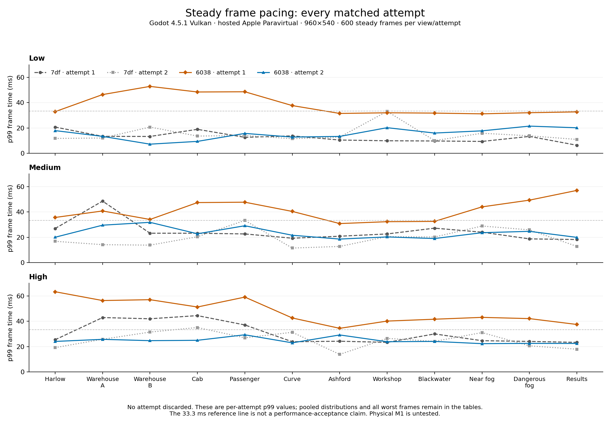

# Milestone 3.5.2 — performance and stability acceptance

**Recommendation: keep [PR #6](https://github.com/oiwdis/last-train-out/pull/6) in draft.**
The multi-second Harlow entry stall is substantially reduced and the complete
journey succeeds, but performance targets remain unmet and the final candidate
**lost its Vulkan device on a fresh Apple Silicon runner**. This is a reproduced
release blocker. Physical 2020 M1 acceptance is also pending. Do not merge.

Runtime: `6038bfcd0f0c5427ae6c53435d2867282938f6e4`.
Exact baseline: `7df2f5abee54b8adcf27b8668263fba231a79033`.
[Final native run](https://github.com/oiwdis/last-train-out/actions/runs/44608806260),
[complete evidence](validation/milestone352/final-native/README.md),
[all twelve locations × three presets](validation/milestone352/final-native/comparison/COMPARISON.md).
CI merge commit `698a5e436ae4ec6001cd2edd7201b03cd9292e15` has the identical file
tree `f2aa373f6e206f10525a46cb9ee99c6f953803ac`. Later report-only changes must not
be confused with a newly tested runtime or a different application binary.

## Work completed before further optimization

The previously unpublished `cc50670` comparison, continuous movie, native tests
and verified universal build were published first, in `5be9f80`:
[completed 3.5.1 evidence](validation/milestone351/final-native/README.md).
Its two baseline cache failures and unfavorable Warehouse B results remain
available. The comparison below is a new complete cohort against `6038bfcd`;
results from different runners are not combined into one distribution.

## Matched performance results

Both revisions used the same hosted macOS 26.7.2 ARM64 runner (3 logical CPUs),
Apple Paravirtual GPU, Godot 4.5.1 Forward+, Vulkan/MoltenVK 1.2.9, 960×540
windowed, Dummy audio, V-sync and frame cap disabled. Three startup processes per revision;
two complete matrices per revision in baseline/candidate/candidate/baseline
order. Each view has 60 entry frames, 120 settling frames and 600 steady frames.
There are 43,200 steady and 4,320 entry samples per revision. Both received the
same diagnostics and post-measurement cleanup helper. No timing run used a
sampling profiler, screenshots, fixed FPS or Movie Maker.

Separate initially empty project/application caches were used per revision.
Imported assets and filesystem were warm; OS/driver caches were shared and
uncontrolled. This is neither a cold-OS launch nor physical-M1 validation.

| Measure | Exact baseline | Final candidate |
|---|---:|---:|
| First source readiness, fresh writable app caches | 39.698 s | 24.186 s |
| Warm source readiness, attempts 2 / 3 | 30.985 / 23.845 s | 19.132 / 17.335 s |
| Medium Harlow worst entry | 1,221.968 ms | 62.324 ms |
| High Harlow worst entry | 2,404.751 ms | 96.794 ms |
| Worst entry, all locations/presets | 2,404.751 ms | 164.593 ms |
| High Warehouse A worst entry | 123.215 ms | 160.749 ms |
| High Warehouse B steady p99 | 39.59 ms | 49.00 ms |
| High cab steady p99 | 40.31 ms | 50.28 ms |
| High passenger steady p99 | 34.51 ms | 58.11 ms |
| High near-fog worst steady frame | 50.13 ms | 56.55 ms |
| Medium dangerous-fog worst steady frame | 35.30 ms | 389.66 ms |
| Worst steady frame, all locations/presets | 1,061.507 ms | 389.657 ms |
| Entry frames >100 ms | 13 / 4,320 | 11 / 4,320 |
| Steady frames >33.3 / >50 / >100 ms | 186 / 36 / 2 | 3,243 / 179 / 6 |
| Peak sampled process RSS | 627.33 MiB | 630.34 MiB |

The largest Harlow stall improves by about 96%, but **consistent pacing is not
accepted**. Most pooled steady distributions regress. Candidate matrix 1 took
855.00 seconds; matrix 2 took 444.11 seconds. High Warehouse B means were
36.16 and 17.72 ms respectively, with p99 57.01 and 24.69 ms. Both remain in the
pooled result. A slower hosted attempt is not discarded or automatically blamed
on virtualization; these data do not separate transient host/driver conditions
from every application contribution. The faster second attempt does not erase
this regression.

The linked tables/CSVs contain every mean, median, p95, p99, worst and
>33.3/50/100 ms count, plus draw calls, primitives, texture/static memory, CPU
monitors, raw callback brackets and pipeline counters. Percentiles are recomputed
from pooled raw frames, not averaged. All 144 fixture-transition durations are
also retained in `comparison/fixture-transitions.csv`: mean/worst 260.713/1,861.192
ms baseline versus 180.338/231.067 ms candidate. These include scripted physics
settling and are not ordinary gameplay loading times or entry-frame samples.

## Startup timeline and responsiveness

The complete matched timeline is in the comparison report. The initial
fresh-runner source probes also remain included: **59.688 / 20.019 / 15.774 s**.
They are a separate population from the later paired cohort.

| Initial source attempt | Engine to script | Script to load | Resource load | Instantiate | Activate | Prepare + ready | Total |
|---|---:|---:|---:|---:|---:|---:|---:|
| 1 | 17.219 | 0.562 | 7.266 | 0.008 | 1.502 | 33.131 | 59.688 |
| 2 | 3.848 | 0.074 | 1.586 | 0.011 | 1.464 | 13.036 | 20.019 |
| 3 | 3.856 | 0.061 | 1.390 | 0.006 | 0.995 | 9.466 | 15.774 |

Times are seconds on the engine's startup clock. The pre-script boundary combines
engine/driver initialization and built-in shader preparation. Resource loading
includes scripts, discovery and imported-resource decompression; activation
includes `_ready`, generated geometry, physics registration and gameplay wiring.
These boundaries do not separately time every internal texture upload, physics
operation or GPU allocation. External process lifetimes and timestamped stdout
are retained; stdout arrival is approximate because buffering is possible.
Process-to-menu is **not applicable**: this game starts directly in the mission.

The first source attempt's fog-material/initial-world draw took 23.012 s, platform
5.855 s and Warehouse A 2.295 s. On warm attempts those stages were 5.490/3.613,
5.052/3.810 and 1.671/1.280 s. The fog label includes surrounding geometry; it is
not an isolated fog-shader cost. Later individual views are mostly tens of ms.
The first matching candidate's scene activation was 2.216 s versus baseline
10.477 s, reflecting the retained CPU geometry fix. Warm readiness still misses
15 seconds. The 59.688-second initial launch prevents claiming robust cold
startup below 30 seconds.

The visible progress overlay advances through render preparation. Engine startup
and the preceding synchronous resource load do not have frame-budgeted progress,
and a long driver call can block a preparation frame. **Whole-launch
responsiveness is not established.** No station-entry loading screen was added;
these costs remain explicit startup/preset preparation, not declared playable
early. Exported baked-shader launches are reported separately from source runs.
The failed fresh exported self-test reached mission readiness at 77.061 seconds;
its extra test scene path is not a matched source-startup measurement.

## What changed, and what the stalls establish

- The existing CPU mesh path avoids uploading and reading back intermediate
  geometry during construction. Detailed meshes, textures, winding and UVs are
  preserved; the previous geometry comparison measured only a maximum 0.000215
  normal-component quantization difference.
- Queue-aware preparation renders each view through the device's frame-queue
  rotation and drains the restored camera before unpausing. The old 2.773-second
  frame spent 2,771.636 ms inside the render callback interval; a separate native
  stack sample identified `_begin_frame → _stall_for_frame → fence_wait →
  vkWaitForFences`. Submitted draws were not proof of GPU completion. The new
  matched Harlow results confirm a substantial reduction, not universal <100 ms.
- The existing HUD fix avoids rebuilding/uploading an unchanged stamina polygon
  every frame. The sampled redundant upload/fence-wait path is a proven avoidable
  cost, not a causal explanation of every fog outlier.
- This continuation adds authored preparation views for Warehouse A and both
  train interiors. **This coverage change did not eliminate the seven High
  Warehouse A specialization-counter increases during measured entry.** Its
  worst entry still takes 160.749 ms (158.986 ms in the render bracket), and the
  second attempt reaches 121.658 ms. Matching a camera marker is insufficient
  evidence that every dynamic render state has been prepared. No acceptance
  claim is made for this attempted improvement.
- The 389.657 ms Medium dangerous-fog outlier spends 382.899 ms in the render
  bracket, versus 0.284 ms process and 0.104 ms physics, with no pipeline-counter
  increase. The 164.593 ms near-fog entry similarly spends 162.851 ms in rendering.
  These are localized to the render/driver path; the exact internal GPU command
  remains unknown. The historical 937 ms High fog frame did not reproduce in this
  baseline cohort, so its elimination is not proved.

High Warehouse B still submits about 653 draws / 1,007,915 primitives; the cab
1,017 / 1,692,756 and passenger car 1,176 / 1,763,702. Texture memory remains about
360.25–360.35 MiB. Steady pipeline counters do not advance. The 103.782 ms
Warehouse B outlier has 98.009 ms render, 4.511 ms process and 0.337 ms physics
brackets. In the two candidate High Warehouse B attempts, mean process brackets
are 0.512 / 0.451 ms and physics 0.157 / 0.141 ms, while render brackets are
34.678 / 16.335 ms. `comparison/callback-costs.csv` retains this breakdown for
every steady view. Draw/geometry/texture demand is effectively unchanged across revisions;
there is no measured draw-call reduction to claim. The full CPU data remain
available, but GPU timestamps are zero/unavailable, and material-switch and
individual shadow-pass timing are not exposed. Callback elapsed time includes
waits and must not be presented as isolated GPU duration. Godot's rolling
process/physics monitors must not be summed with these brackets to invent cost.

No detailed model, fog layer, shadow preset or gameplay rule was removed to
improve a score. Low/Medium/High remain distinct; all four fog danger states,
exposure/damage, shelter and seeded events are preserved. No visual-quality
reduction or new art pass is claimed.

## Vulkan device loss and shader caches

The original High-preparation timeout and successful retry remain in the
[3.5.1 investigation](PERFORMANCE_MILESTONE351.md). A separate fog-only
preparation experiment at `1cbd924` reproduced **5/6 device losses on two runners**.
All six attempts, including the successful one, are retained in
[the rejected experiment](validation/milestone352/preparation/README.md).
Isolating the fog quad concentrated the next view's first pipeline work; failures
followed the isolated pass before the full platform completed. The original
initial-world view was restored. This was a rejected experiment, not a fix of
the historical driver problem.

**Final-candidate reproduction:** fresh ARM job
[135898602081](https://github.com/oiwdis/last-train-out/actions/runs/44608806260/job/135898602081)
passed its headless launch, then its windowed self-test crashed with exit 133 /
SIGTRAP. The raw log contains Metal command-buffer timeout, `VK_TIMEOUT`, failed
fence wait and `Vulkan device was lost`. It reached mission readiness, movement,
carrying and perspective checks before the preset sequence failed. The final
printed warmup has 112 draw pipelines; no complete self-test JSON was written.
The same artifact passed on the build runner. That earlier pass does not override
the fresh-runner failure. No retry is substituted for it.

`VK_EXT_device_fault` is unavailable; the log cannot identify the precise failing
GPU command. RSS/texture monitors do not provide complete GPU allocation or prove
an OOM. Pipeline/resource bursts, synchronization and hosted-driver behavior
remain possible contributors; no demonstrated GPU use-after-free is asserted.
The predetermined exported series is complete: **29/31 processes succeed; two
cold High launches lose the device**. All ten cold and ten warm launches were
attempted; none was timed out, skipped or replaced. [Every attempt and stage](validation/milestone352/final-native/stress/STRESS.md)
and the unchanged `release-stress.zip` include both macOS `.ips` crash reports.
The 19 min 53.03 s series used the exact exported pack, private writable caches,
960×540 windowed Vulkan and Dummy audio. The app bundle and normal save directory
were not modified. Baked shaders and OS/driver caches remained shared.

| Exported stress group | Outcome | Mission readiness / detail |
|---|---|---|
| Ten fresh writable-cache launches (4 Low / 3 Medium / 3 High) | **8 pass, 2 device losses** | Successful readiness 21.875–89.107 s; cold 3 and 6 fail before readiness, both High |
| Explicit all-preset warm-cache seed | Pass | Full 72-row short matrix |
| Ten warm launches (4 Low / 3 Medium / 3 High) | 10 pass | 16.466–20.564 s; every one exceeds 15 s |
| Three lifecycle processes | 3 pass, 35 checks each | Nine actual Save/Continue cycles, three restarts, 36 preset requests with fog activation |
| Three exits during active preparation | 3 pass, 3 checks each | Controller/pause retirement succeeds |
| Three further all-station matrices | 3 pass | 72 rows each; entry/steady worst 236.544 / 259.204 ms across these attempts |
| Private-cache isolation preflight | Pass, headless | Separate control check, not GPU startup timing |

The two cold crashes exit with SIGTRAP (-5) after 27.489 / 30.971 seconds, at
sampled peak RSS 482.27 / 480.19 MiB. Both logs last complete the initial fog/world
and platform preparation phases, with 35 then 76 specialization counts; they
never report mission readiness. Buffered stdout/stderr ordering does not locate
the exact offending command. The `.ips` stacks agree at
`RenderingDeviceDriverVulkan::command_queue_execute_and_present →
RenderingDevice::execute_chained_cmds → _execute_frame → swap_buffers` on the main
thread. This confirms the fatal device-loss path, not the underlying GPU timeout
cause. A reported 4,778 MB budget and process RSS do not establish or exclude GPU
memory pressure. The successful third cold High launch does not erase the other
two failures. Every cold process logs a 0.0 MiB initial PSO cache; the explicit
seed saves 15.3 MiB and all ten warm launches load it. Later lifecycle work grows
it to 15.7 MiB. The CSV directory inventory covers `user://shader_cache`, not all
PSO storage; engine load/save events provide the separate pipeline-cache evidence.

The first cold Low launch takes 89.107 s: 28.285 s engine-to-script, 0.559 s to
loading, 4.979 s loading, 0.136 s instantiation, 6.334 s activation and 48.814 s
preparation/readiness. This is unfavorable exported-app evidence and remains
included. Peak sampled RSS for the whole series is 585.875 MiB. Release-build
static-memory counters reported zero and are not treated as literal zero memory;
external RSS and texture counters are retained. The 24-sample / 8-settling-frame
stress matrices are stability fixtures, not replacements for the full matched
performance distributions. Their 236.544 ms entry miss is an additional failure
of the 100 ms target.

The reproducible `VK_INCOMPLETE` cache-serialization error is distinct from fatal
device loss. Both baseline startup 1 and matrix 1 report it in this cohort.
The retained 128 MiB threshold avoids repeated writes during the observed working
set and still saves on clean exit: candidate startup saves 10.4 MiB, warm launches
reuse it, and the full matrix saves 15.3 MiB. All candidate paired processes have
zero engine diagnostics; [cache verification](validation/milestone352/final-native/comparison/cache-check.txt)
passes. Shader-code cache misses are 94 on the first source launch and zero on
warm launches. An abrupt kill can lose the latest PSO additions and increase the
next preparation cost. No driver error is filtered out, and this cache change
does not prevent the final fresh-runner device loss.

## Resource cleanup

Four meaningful additions preserve all original 300 test identities, bringing
the suite to **304**. Existing scene-owned preparation cancellation and actual
mixer-ownership retirement are retained. New evidence exposed two additional
paths:

1. `TestSuite.free_spawned` had still freed fixtures after a small frame count,
   bypassing real audio retirement. A native run leaked five WAV/playback owners
   despite passing assertions. The fixture now uses the bounded retirement
   helper; the new ownership test fails before and passes after the fix.
2. Godot 4.5.1 `AudioStreamPlayer3D.play()` retains a pending `setplayback` Ref
   before its first physics update. `stop()` does not clear that separate Ref.
   A scene paused for preparation can exit before the first tick. The helper now
   stops/clears and queues spatial players for deletion before awaiting remaining
   mixer owners. Its deadline also requires actual main-thread update
   opportunities. A timing-only attempt did **not** fix the pending owner; both
   failed approaches and successful regressions are retained.

[Fixture evidence](validation/milestone352/fixture-retirement/README.md) and
[early-exit evidence](validation/milestone352/early-spatial-retirement/README.md)
include failing tests, full logs and final local validation. Diagnostic cleanup
occurs after timing samples; normal gameplay audio is unchanged. The intermediate
`f9ca998` native run was cancelled after the additional local early-exit problem
was found; its completed checks and partial comparison remain in
[the intermediate archive](validation/milestone352/intermediate-f9ca/README.md).

Final full suites, initial startups, six rendered regressions, paired candidate
processes, build-runner exported launches, the full recording and all 29 successful
exported stress processes have no ObjectDB/resource-in-use errors. The three
repeated lifecycle processes end with 46 / 45 / 45 MiB in MoltenVK's pre-release
snapshot; this is not a demonstrated zero GPU heap or proof of every internal
resource lifetime. `stress/cleanup-diagnostics.csv` retains every process outcome. A crash is not a successful cleanup test.
Verbose Godot still reports the engine `servers` StringName; Linux OpenGL probes
also retain the environment's unsupported V-sync warning. Neither is silently
removed. MoltenVK logs 12 MB after startup / 55 MB after the rendered lifecycle
workload. Its source samples `MTLDevice.currentAllocatedSize` **before** releasing
the Metal device: this is not a post-process leak measurement or an ObjectDB
owner report. It also does not prove every allocation harmless. Details and the
source link remain in the native evidence README.

## Functional validation, recording and application

- Linux: **304/304**, 138.9 s; macOS: **304/304**, 100.4 s. All original 300 test
  identities remain present and passing.
- Native Vulkan lifecycle: **6/6**, 128.7 s, including rapid presets, fog-material
  identity, cancellation and Continue during preparation with rider and cargo.
- Continuous journey **167/167**, fuel recovery **35/35**, natural fog failure
  **24/24**, separate-process resume **17/17**. The rendered movie independently
  passes the same 167 journey checks with zero travel teleports and one legitimate
  Blackwater save restoration.
- Exported stress: **29/31 processes succeed**, including 10/10 warm launches;
  **2/10 cold launches fail with device loss**. All scheduled attempts, including
  both failed macOS crash reports, are preserved.
- Universal export, asset inventory, baked shader inventory, bundle/ZIP integrity
  and ad-hoc signature checks pass. Build-runner ARM launches pass 46 headless /
  49 windowed checks. Fresh Intel headless passes 46; fresh ARM headless passes
  46, but its windowed launch **fails with device loss** and the following packaged
  81-case diagnostic is skipped. Intel GPU rendering is not validated.

[New continuous movie](recording/milestone352-full-journey.mp4): **23:30.42**,
960×540 Medium, fixed **12 FPS offline Movie Maker**. Normal scripted movement and
interaction inputs cover Harlow scavenging/carrying, the full 4.26 km journey,
Ashford coal/refueling, fog pursuit, Blackwater, actual Save/Continue and final
results. No cuts or time acceleration were applied; every captured frame is
retained. Offline capture does not measure real-time FPS and cannot demonstrate
wall-clock responsiveness during a driver stall. Normal-play physical acceptance
remains necessary. Movie SHA-256:
`b8492b2ea4a2107ff16c821aa0fa40e81db78a86f001735d448e291a644c5aab`.

[LastTrainOut-macos-universal.zip](https://github.com/oiwdis/last-train-out/actions/runs/44608806260/artifacts/14576722679)
is a **development artifact with the documented ARM GPU failure**, not an accepted
release. It contains `Last Train Out.app`, including Godot, with arm64 and x86_64
Mach-O slices and executable permissions. Size 292,540,491 bytes; independently
verified ZIP CRC and SHA-256:
`e1cff244b9edf7a8af1b6371ad311a4cf0fafa79301beb3ecaec2517ae837159`.
Ad-hoc signed, **not notarized**. Optional signing/notarization remains in CI and
was not requested or performed.

## Acceptance blockers and smallest next actions

| Gate | Status | Next action |
|---|---|---|
| Existing tests, full journey, export and recording | Pass for this runtime | Keep their exact artifact/source identity |
| Fresh ARM rendering | **Failed: reproduced Vulkan device loss** | Diagnose this exact failure/pack with a GPU-capable native capture; a retry alone cannot close it |
| Extended cold/warm/lifecycle stress | **Complete, failed: two cold High device losses** | Use both retained crash reports and phase logs to diagnose the cold preparation path; do not substitute the successful High attempt |
| Startup <30 s cold / <15 s warm | **Not met: exported cold up to 89.107 s; warm 16.466–20.564 s** | Measure this ZIP on physical M1; profile initial GPU preparation and synchronous loading where it misses |
| All entry frames ≤100 ms | **Not met: matched 164.593 ms / 11 misses; exported short stress 236.544 ms** | Capture remaining Warehouse A render-state specialization and near-fog synchronization paths |
| Steady pacing / interiors / fog | **Not accepted: pooled regressions; 389.657 ms fog frame** | Repeat the unchanged fixed matrix on controlled physical hardware with GPU timing; retain both existing attempts |
| Whole-startup responsiveness | **Not established** | Record normal cold launches and correlate visible freezes with engine/load/preparation boundaries |
| Physical 2020 M1 fullscreen | **Pending acceptance blocker** | Owner runs [the reproducible procedure](M1_MILESTONE352.md) on the exact ZIP and returns all raw results |
| Human merge approval | Pending | Consider only after failures are resolved or explicitly accepted; do not merge automatically |

The source-stage, hosted-driver and physical-device limitations are explicit.
The report does not claim the GPU crash is fixed, the added views solved every
entry miss, or that a green build job establishes release readiness.
