# Milestone 2.6 — environment continuation

Eight matched views compare `86b247337348ead8aaaf03f841c2277498f8b08e` with the environment continuation on `feature/milestone-2-6-photorealism`. Both use Godot 4.5.1 **Forward+**, **High**, **1280×720**, the same feet/camera/target/FOV and the same overcast lighting. The images are raw viewport captures; no image enhancement is applied.

The new assets include the CC0 factory kit and benches, original detailed freight containers/vans and roof assemblies, replacement supply props and sparse vegetation. Distant scenery, generic doors/ladders and several structural blocks remain visibly simplified; these images do not establish full photorealism.

The freight-yard camera is outside Warehouse B's trim in **both** versions. The original M2.6 gallery used a camera intersecting the trim and showed large clipped triangles. That old angle is not used for this comparison.

[Before camera poses](before/camera_poses.json) · [After camera poses](after/camera_poses.json) · [Capture verification and PNG checksums](capture.json)

| View | Before | After |
|---|---|---|
| Platform and hall windows | 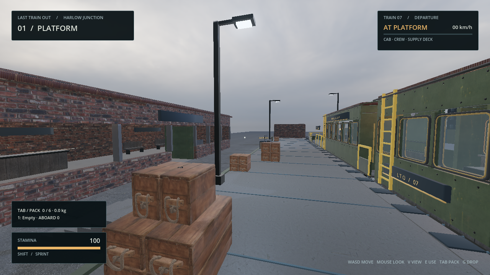 | 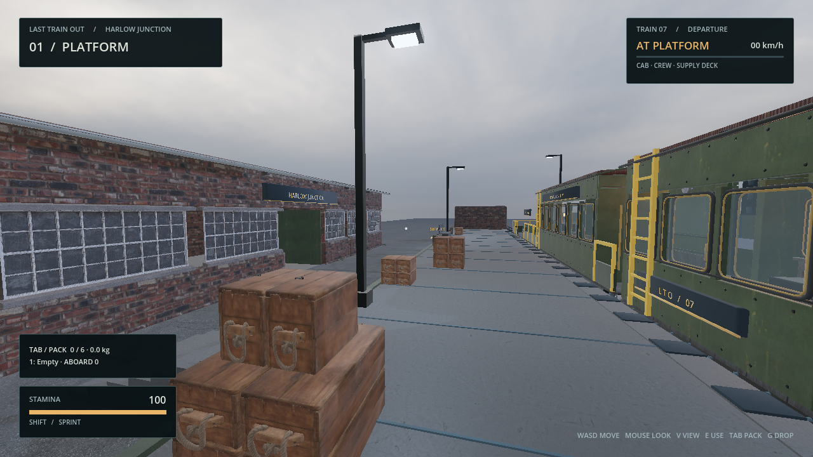 |
| Waiting-hall facade | 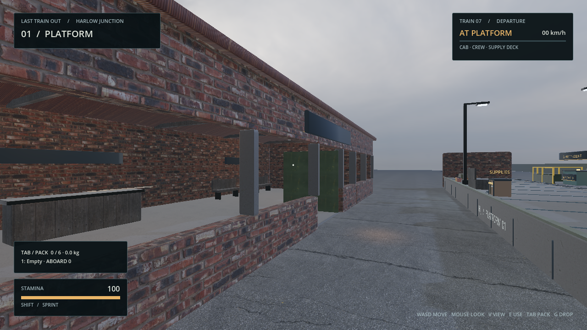 | 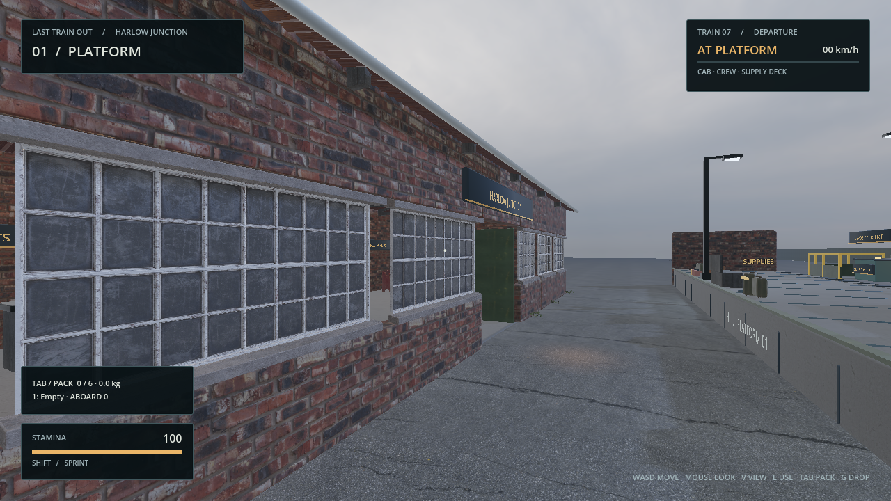 |
| Station-house masonry and roof | 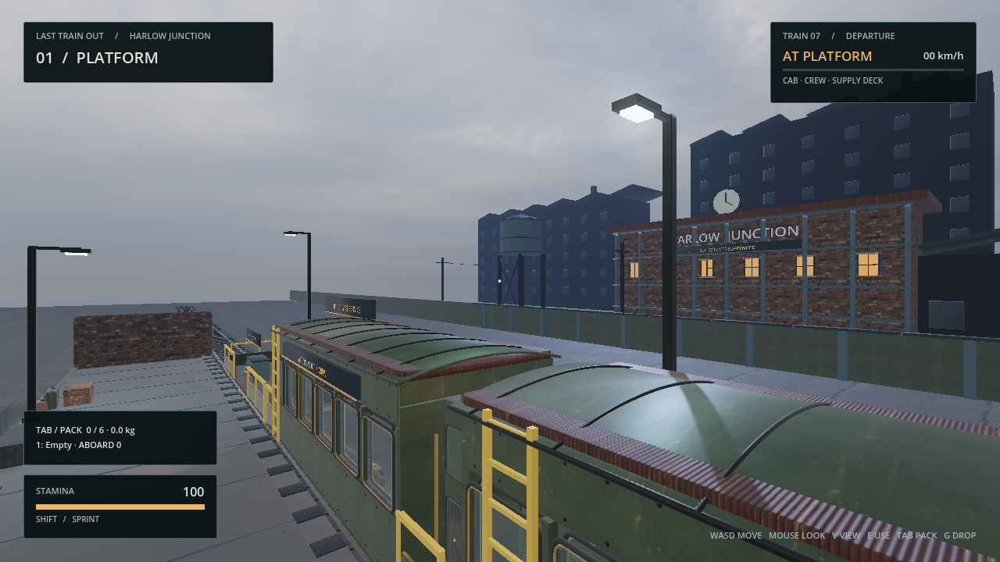 | 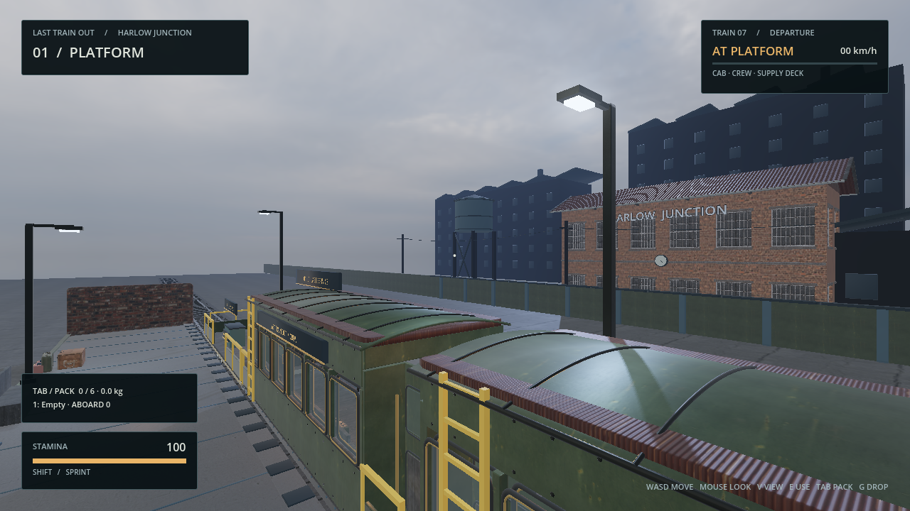 |
| Warehouse A | 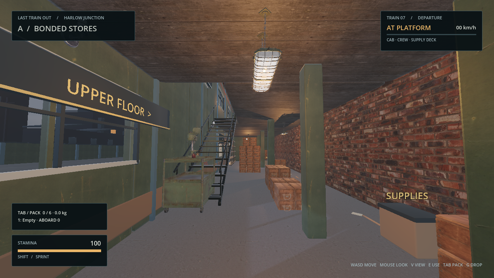 | 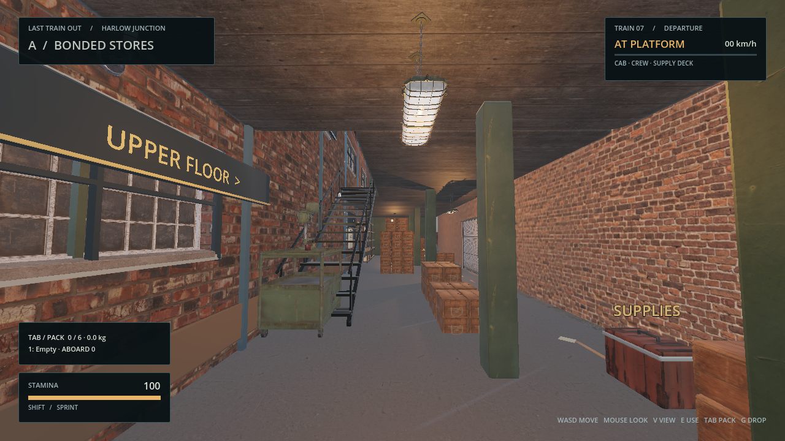 |
| Warehouse B | 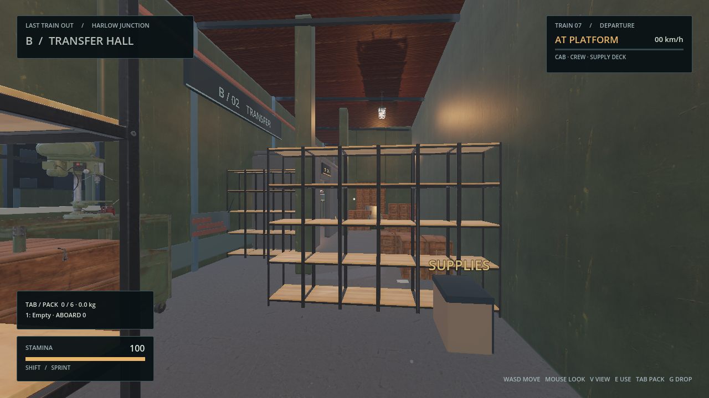 | 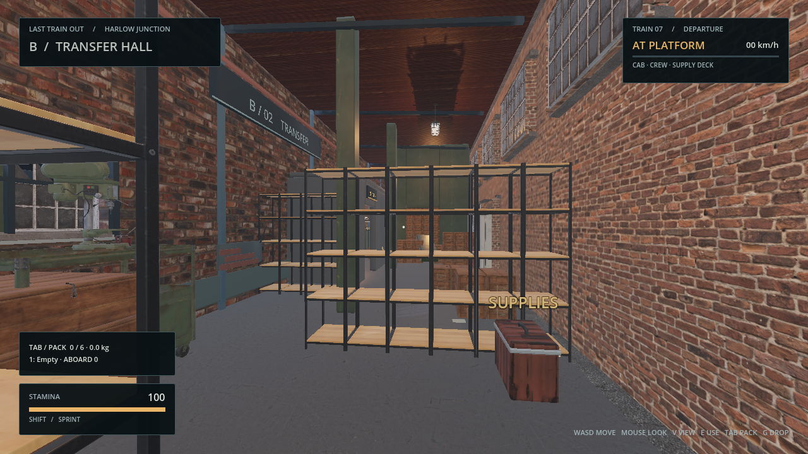 |
| Freight-yard route | 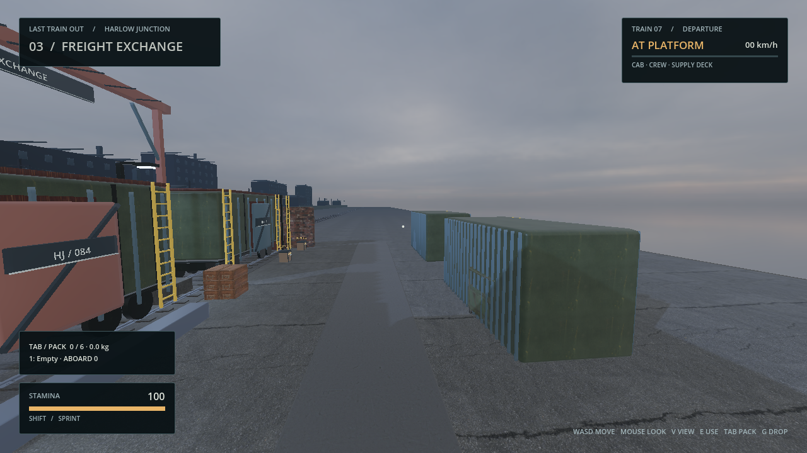 | 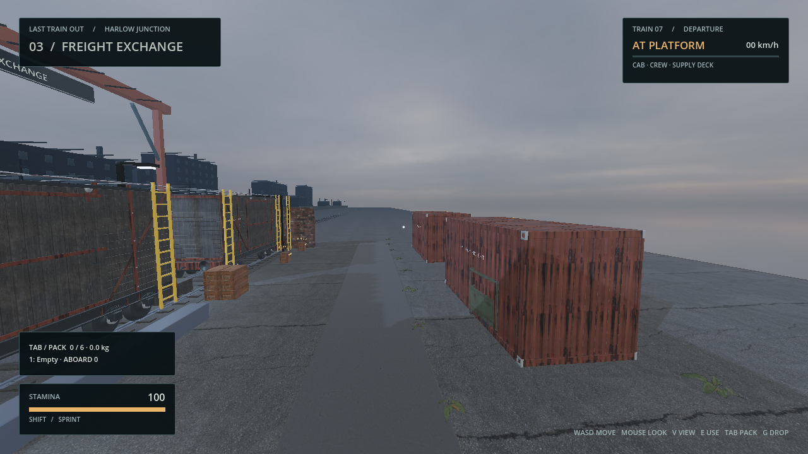 |
| Parked timber box vans | 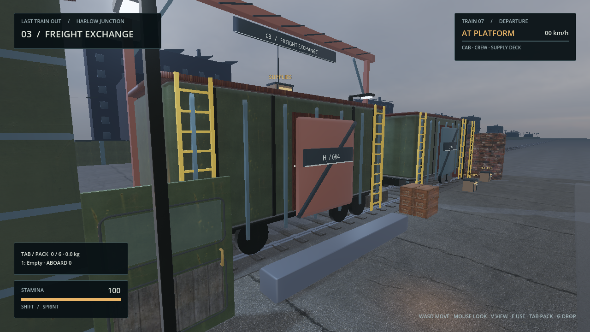 | 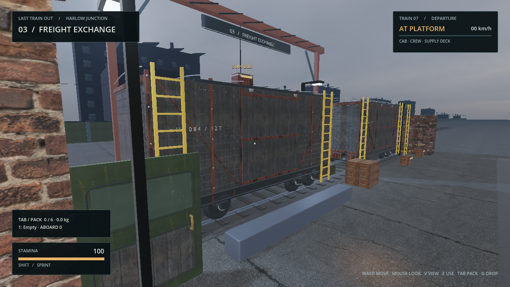 |
| Container doors and hardware | 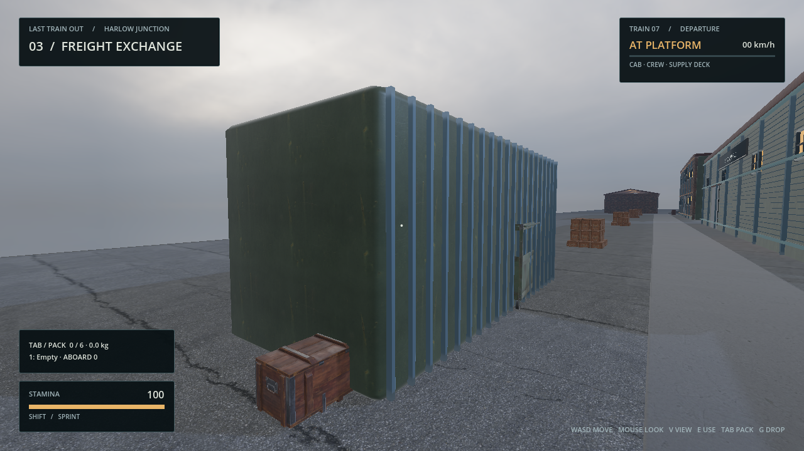 | 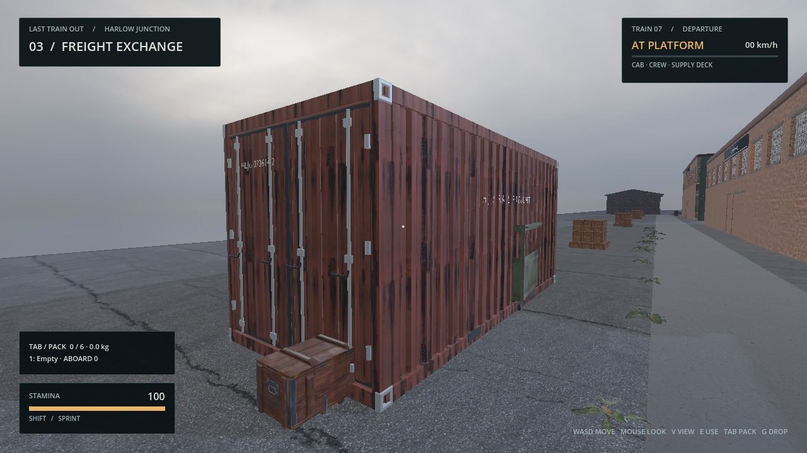 |

Reproduce with `tools/capture_environment.tscn`. Copy the exact same capture script to the baseline checkout and pass `-- --out=<directory>`. These stills are visual evidence, not frame-rate measurements.
