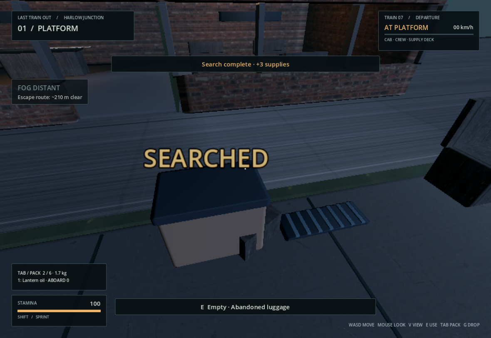
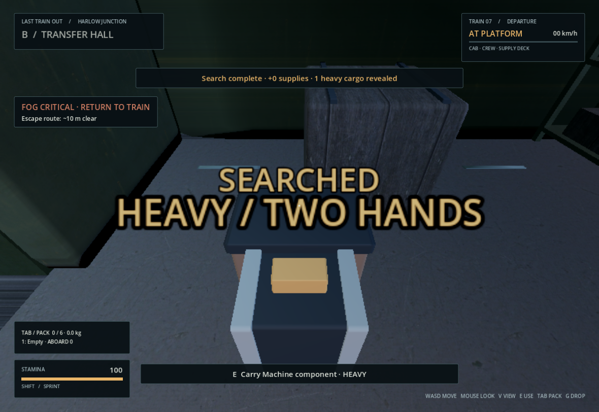
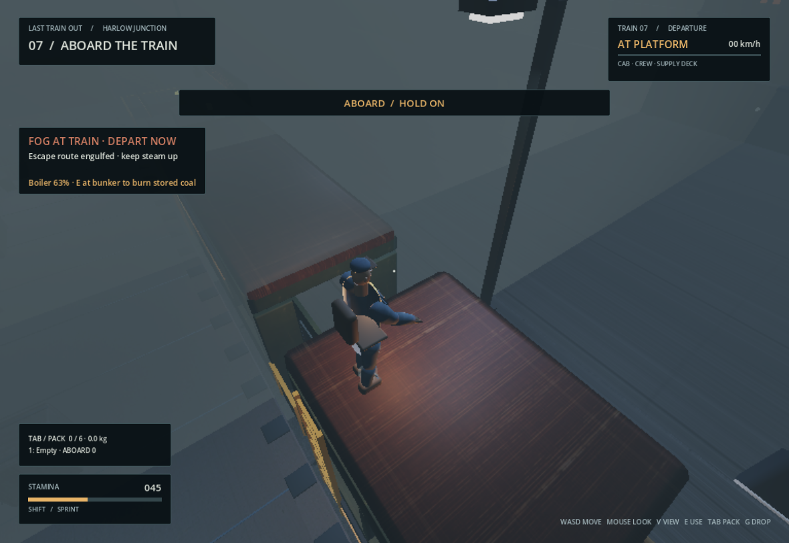
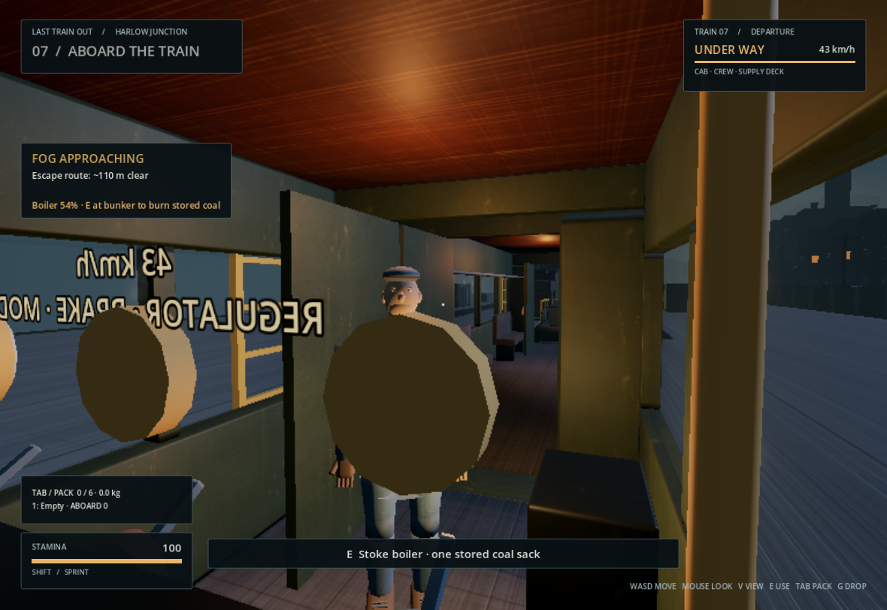
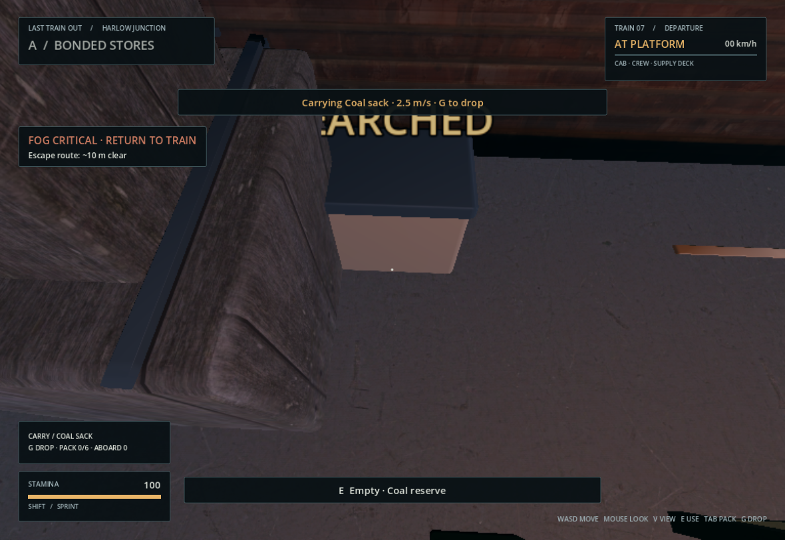
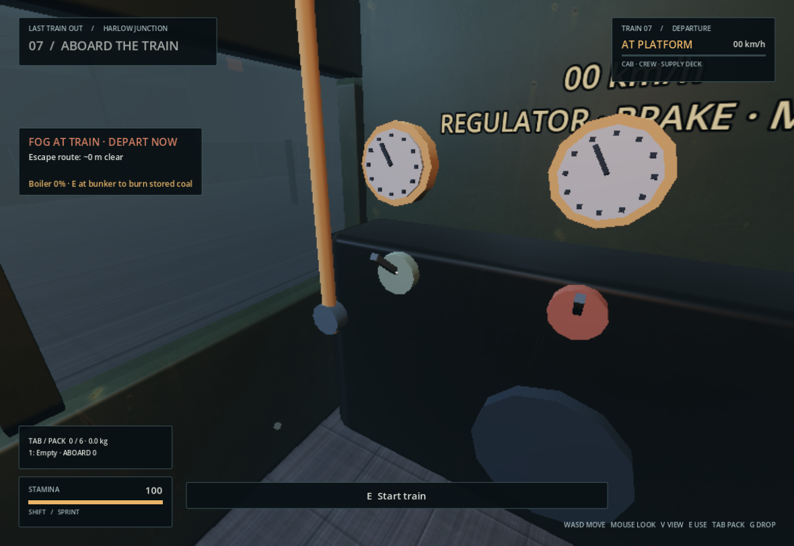
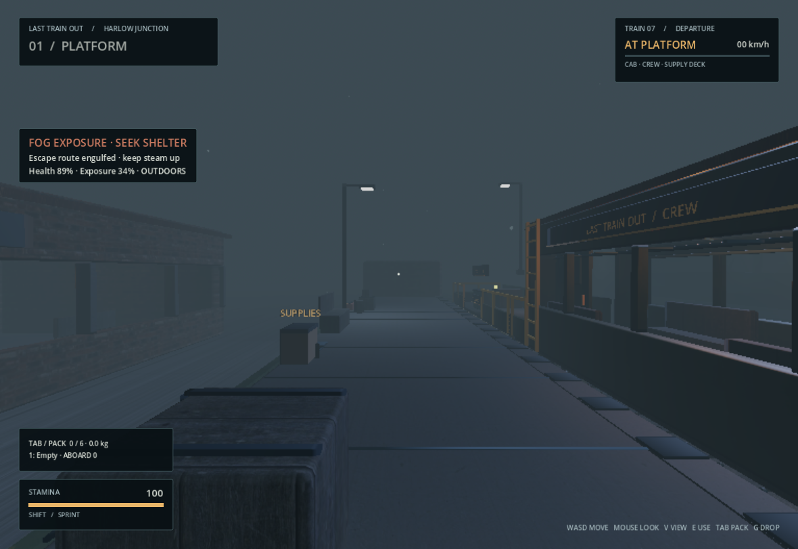
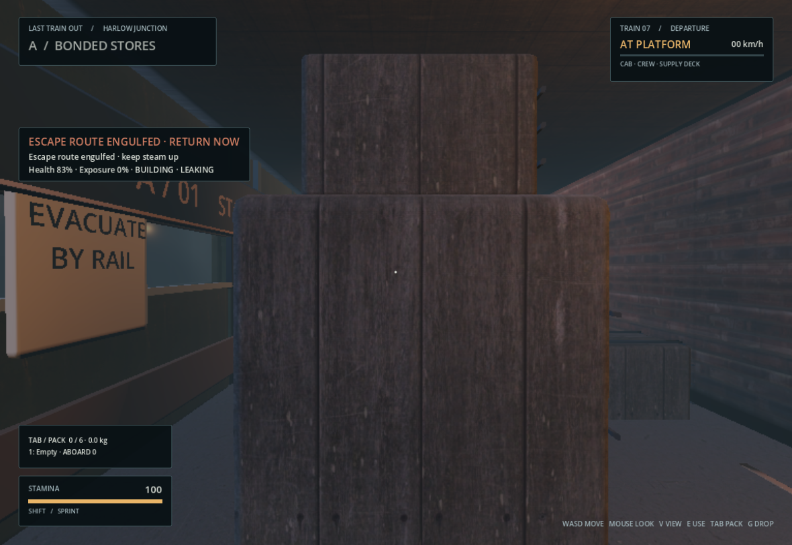
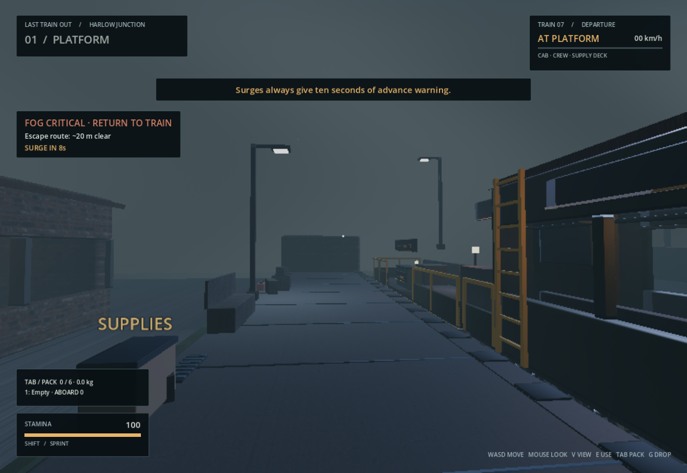

# Milestone 3 gameplay captures

Direct viewport screenshots from the Low/Compatibility 24 FPS scripted gameplay recording on Godot 4.5.1. Actual viewport: 1180 × 812 (the cloud window manager resized the requested window). They use the stable M2.5 assets, not the unfinished M2.6 art. No image generation or retouching was used.

| Scavenging and urgency | Escape and recovery |
|---|---|
|  |  |
|  |  |
|  |  |
|  |  |

[Gameplay method and setup cuts](../../FOG_VALIDATION.md) · [Recording](../../recording/milestone3_survival.mp4)
