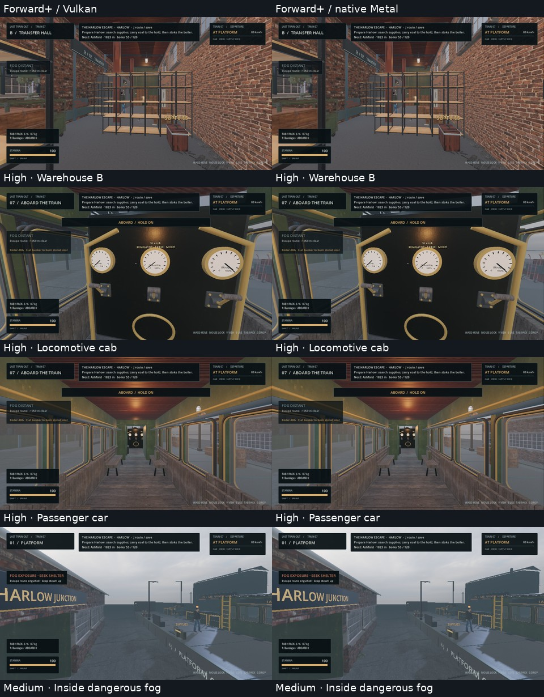

# Forward+ driver comparison in the exported game

One hosted macOS arm64 Apple Paravirtual GPU ran the same universal executable and PCK four times at 960×540, with V-sync off. The run order was Vulkan, Metal, Metal, Vulkan. Each driver had its own initially empty writable user cache and retained it for the second pass. Every matrix contained 60 entry, 60 settling and 180 steady frames in each of 36 views. The two additional capture processes used 24 steady frames and eight settling frames and are excluded from the timing table. The resolved driver matched the request in all six processes.

| Steady rendering across 12,960 intervals per driver | Vulkan | Native Metal |
|---|---:|---:|
| FPS from pooled mean | 98.65 | 125.20 |
| Median / p95 / p99, ms | 9.462 / 17.030 / 21.166 | 7.223 / 13.299 / 18.382 |
| Worst, ms | 50.960 | 655.378 |
| Frames over 100 ms | 0 | 2 |
| Peak RSS, first / second timed process, MiB | 525.33 / 524.81 | 645.94 / 573.58 |

| Preset, location and measure | Vulkan, ms | Native Metal, ms |
|---|---:|---:|
| High Harlow, worst entry | 74.253 | 44.135 |
| High Warehouse B, steady p99 | 26.834 | 19.520 |
| High locomotive cab, steady p99 | 25.151 | 20.712 |
| High passenger car, steady p99 | 25.996 | 25.441 |
| High passenger car, steady worst | 30.686 | 38.853 |
| Medium dangerous fog, steady worst | 17.684 | 20.374 |
| Low Warehouse A, steady worst | 25.144 | 655.378 |

The second Metal run recorded 291.450 and 655.378 ms in Low Warehouse A, separated by one frame. Their render callback brackets took 290.790 and 654.195 ms. Physics and process brackets each took under 0.22 ms, render setup CPU took under 0.05 ms and the steady window added zero surface, draw or specialization pipelines. The backend provided no physical GPU timestamps. The elapsed intervals establish where the application waited but cannot distinguish device execution, driver or host scheduling. The worst frame is retained in both the per-view and pooled distributions.

Both drivers showed the same cab gauges, passenger seats, brick, shelf, fog boundary and exposure HUD at the reference cameras. The sample captures show small differences in shading and particle position. The game retained the same materials, assets, cameras and presets. On the scaled presets, native Metal ignored the requested sampler LOD bias and logged a warning. These screenshots cannot establish texture equivalence over motion or on a physical M1.

All three Metal processes completed and each logged the sampler warning. The original Actions job reported success using a line-prefix detector. The corrected audit found the severity marker interrupted another line. Vulkan completed all three without a diagnostic.

[Original archive with all 72 screenshots and full intervals](native-metal-driver-comparison.zip) · [Paired distributions for all 36 views](pooled.csv) · [Per-attempt CPU, draws, primitives and memory](frames.csv) · [Original and corrected diagnostic counts](attempts.csv) · [Hosted artifact](https://github.com/oiwdis/last-train-out/actions/runs/44679367120/artifacts/14604444272)
