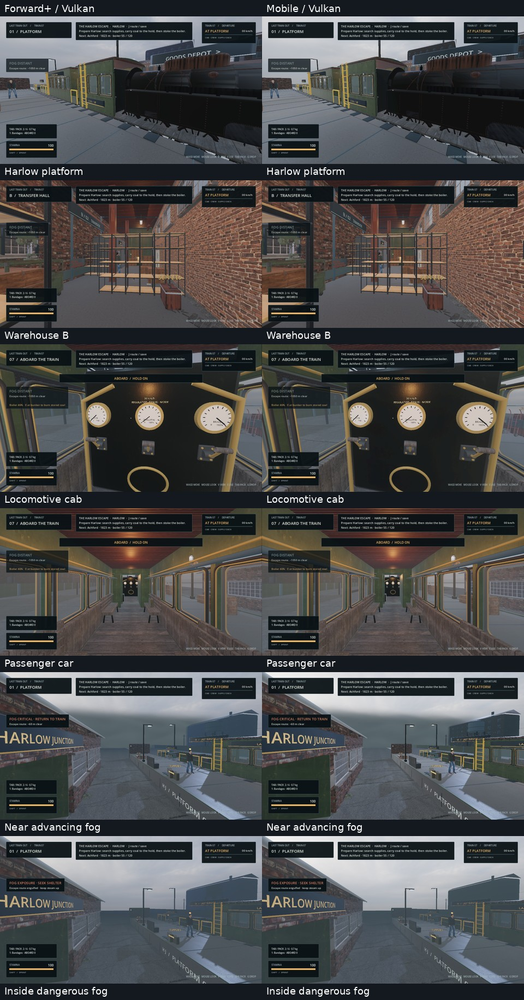
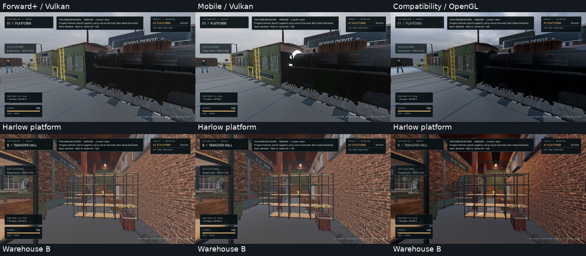

# Renderer comparison on hosted macOS

These experiments used Godot 4.5.1 with matched 6038bfcd source, 960×540 windowed and uncapped frame timing. The source runner alternated three cold/warm High pairs per method. It then measured a complete matrix per method and ran a separate screenshot pass, with independent caches for each backend. The packaged comparisons used the original downloadable 6038bfcd ZIP. The native driver printed its adapter at initialization even in processes that never wrote a complete report.

| Backend and adapter | Source High cold / warm completion | Original export High cold / warm completion | Source ready, cold then warm (s) | Highest sampled startup RSS |
|---|---|---|---|---:|
| Forward+ / Vulkan, Apple Paravirtual | 3/3 and 3/3 | 3/3 and 3/3 | 60.409, 25.615, 23.083 / 22.475, 19.153, 21.227 | 539 MiB |
| Mobile / Vulkan, Apple Paravirtual | 3/3 and 3/3 | 2/3 and 3/3 | 23.268, 16.341, 15.922 / 18.540, 12.908, 13.579 | 494 MiB |
| Compatibility / OpenGL 4.1, Apple Software Renderer | 0/3 and 0/3 | 0/3 and 0/3 | Every launch exceeded the 180 s deadline | 2,385 MiB |

Mobile's first exported launch exceeded 180 seconds. All six Compatibility launches in each format timed out. The source timing and screenshot matrices also reached their 600 s and 480 s deadlines before completing their first location. Compatibility emitted 136 BPTC RGBA-to-RGBA8 conversion warnings and one BPTC RGBFU-to-RGBHalf warning per source process. Its first whole-scene Low preparation took 367.942 s in the timing run. A missing OpenGL frame distribution on this hosted software adapter is a measured failure. Native accelerated OpenGL performance on a physical Mac remains unknown.

| Source matrix | Frames | FPS from pooled mean | Median ms | p95 ms | p99 ms | Worst ms | >100 ms | Peak reported texture MiB |
|---|---:|---:|---:|---:|---:|---:|---:|---:|
| Forward+ / Vulkan | 6,480 | 98.56 | 9.447 | 16.282 | 19.917 | 71.218 | 0 | 360.35 |
| Mobile / Vulkan | 6,480 | 137.96 | 6.552 | 12.823 | 18.962 | 58.686 | 0 | 339.43 |
| Compatibility / OpenGL | 0 completed steady intervals | — | — | — | — | — | — | — |

Each successful run contributed 180 steady frames per location/preset. Pooling across presets gives equal weight to each view in this suite. On High, Warehouse B p99 measured 17.27/15.92 ms on Forward+/Mobile, passenger car 33.11/18.85 ms, cab 20.03/23.36 ms, and dangerous fog 15.34/41.05 ms. Dynamic scene and GPU workload change which backend is faster. Full entry and steady results, CPU/physics/render-server time, texture bytes, primitives and draw calls are provided in the CSV. The Vulkan renderer did not return GPU timestamps.

The paired High captures show the same figure and silhouette on the Harlow platform, the same cab gauges, carriage seats, Warehouse B rack and brick textures, and the fog boundary and exposure HUD. Mobile shows brighter areas in the sky and differences in shading on the distant depot. The central train interiors are close at these viewpoints. Forward+ supports SSAO and hardware-gated volumetric fog; Mobile and Compatibility lack those effects. The painted fog sheets and ordinary distance fog remain. Visual judgments here apply only to these cameras and adapters.

[Original 72 full-resolution screenshots, all logs and raw intervals](backends-native.zip) · [Every timed frame distribution](pooled.csv) · [Per-process CPU, draw and memory](frames.csv) · [Attempts and diagnostics](attempts.csv) · [Original exported launch results](../exported-experiments/EXPERIMENTS.md)

The hosted Compatibility screenshot run returned no image before the deadline. As a separate visual check, the original exported PCK rendered these High views with Godot's Linux OpenGL 4.5 backend and Mesa llvmpipe at 640×360. The locomotive, platform figure and brick surfaces are visible. Timing and color from this software renderer cannot establish how a physical M1 draws the same scene.

[Linux Compatibility platform](linux-compatibility/2-harlow_platform.png) · [Linux Compatibility Warehouse B](linux-compatibility/2-warehouse_b.png) · [Fixture used for these Linux images](linux-compatibility/fixture.gd.txt)

The supplemental Linux OpenGL process reached its 1,600 s deadline after recording Harlow and Warehouse B and entering the cab. The launch used a 12-frame steady sample at each location. This process is excluded from the hosted numerical tables. Its partial output is retained in full.

[Supplemental Linux log](linux-compatibility/raw.log) · [All flushed Linux intervals](linux-compatibility/result.json.jsonl)

The Linux comparison used the same original PCK, High preset, 640×360 viewport and fixture cameras for all three methods. Vulkan Forward+ and Mobile finished all five reference views. In the two views available from all three, OpenGL darkens the black locomotive paint and makes Warehouse B's ceiling and brick lighting warmer. Steam and other time-driven effects were captured on different frames. This supplementary comparison is for appearance only. Sample counts differ between its OpenGL and Vulkan passes.

[Every Linux image, original fixture, reduced screenshot sampler, exit status and partial intervals](linux-visuals.zip)
