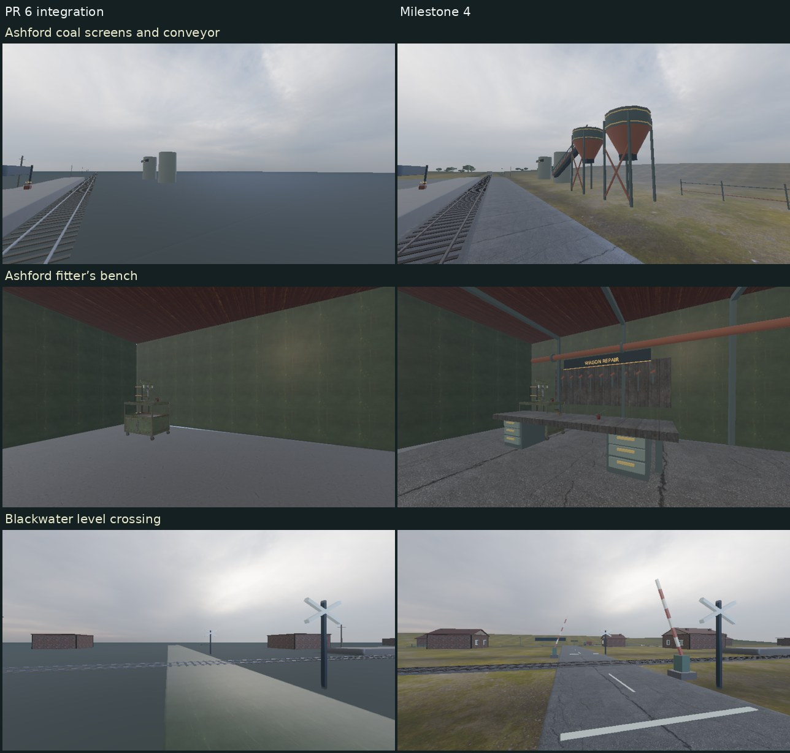
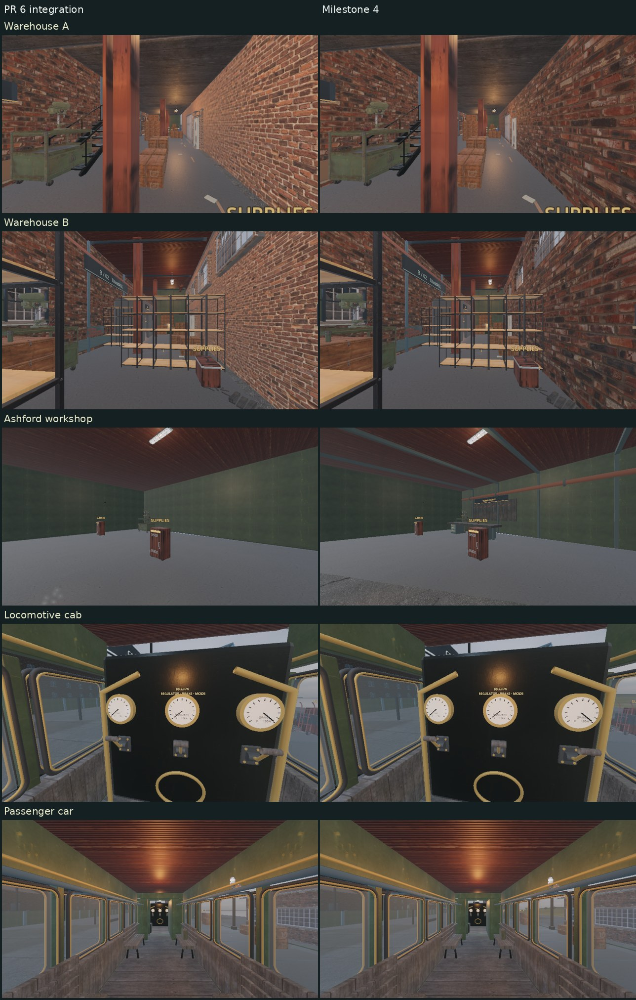

# Native Metal environment gallery

The left column shows the PR #6 integration build. The right column shows Milestone 4. Each pair uses the same 960 × 540 camera, field of view, observer position, Medium preset and fog-front position. These JPEG sheets reduce the images to 640 × 360 per panel. The lossless image archive contains all 114 original PNGs covering 16 measured views plus three station detail views per build on Low, Medium and High. [Original native PNGs](native-pngs.zip)

## Harlow Junction and Bonded Stores

The replacement main line in the integration build showed white ballast and sleepers. The new line carries gravel and timber under dark rails with a distinct running head. At the warehouse corner, the masonry return reaches the green side wall on its interior face.

## Railway, Ashford and Blackwater

The 2,020 m viewpoint looks along a bend. The ditch, shoulder and poles follow the route, while the meadow crosses chunk boundaries. Ashford's hoppers and overhead freight crane identify the depot from the line. The cottage gables, crossing and shopfront distinguish Blackwater.

The near-black terrain mask in the rejected Medium build covered 19.04% of the bend and 22.31% of Crossing Stores. Build 111 recorded 0.00% at both fixed cameras on all three presets. The continuous journey also renders the Blackwater foreground through the frame that previously flashed black. [All preset measurements](daylight-fields.csv) · [Consecutive gameplay frames](blackwater-film-comparison.jpg)

## The coal screens, fitter’s bench and level crossing

These are supplementary camera positions from the packaged game. The matched images retain the conveyor and coal-screen approaches, the workshop back wall, and the driver’s view across the level crossing.

## Fog on approach and inside the front

The three pairs retain the actual hazard display. View them in order to compare the boundary silhouette and how much of the train and station remains visible as the front passes.

## Warehouses, workshop and train interiors

The fixed interior views show the warehouse returns, Ashford's fitter's bench and the appearance of the locomotive and passenger car under the same renderer.

[Frame-time measurements](FRAME_TIMES.md) · [Environment report](../../MILESTONE4_ENVIRONMENT_OVERHAUL.md)
