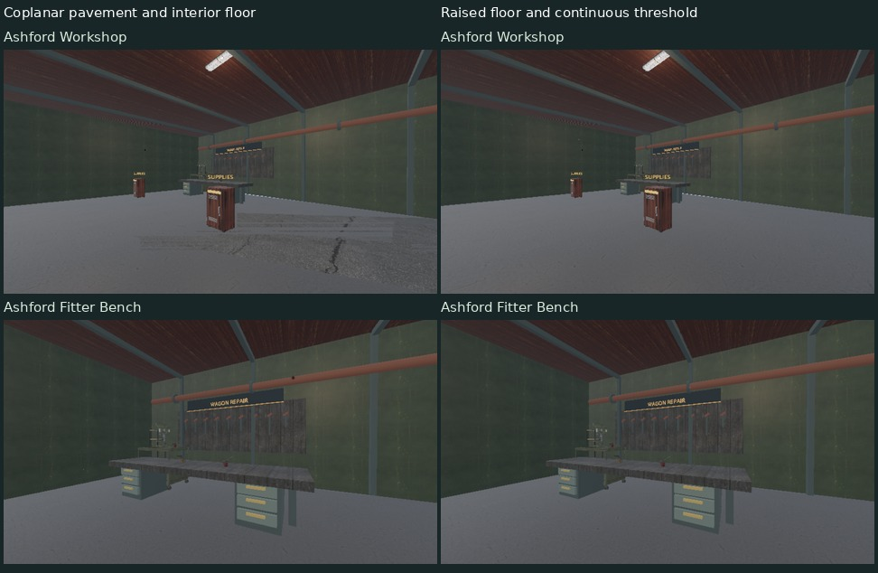

# Ashford workshop floor

In the build 111 native gallery, a triangular patch of cracked outdoor asphalt crosses the workshop floor. The depot pavement extends beneath Freight Stores, Maintenance and the Depot Office. All three finished slabs and the pavement had their top faces at exactly the same world height. A ray cast inside the Depot Office could select the outdoor pavement. [Original hosted native gallery](https://github.com/oiwdis/last-train-out/blob/6fd54cd360ee57ed47f4c4d1721baec6187507db/docs/validation/milestone4/GALLERY.md)

The three depot buildings now stand four centimetres above the yard. Their original door thresholds rise from the apron to the slab. Six collision samples through each doorway reach the rendered floor continuously. The cache and objective locations retain their original coordinates.

A separate Godot 4.5.1 session on Linux rendered each camera with the real apron visible and hidden. Only the pavement's drawing was toggled during the comparison. Its collision, the floor material, the camera and the lights stayed in place. In the bottom strip of the workshop view, hiding the apron changed 0.17% of pixels on Low, 16.15% on Medium and 63.91% on High before the repair. All three measured 0.00% after the repair. The closer bench camera measured 0.00% in both versions on this software Vulkan adapter. The native camera images remain a separate check. [All 24 images, measured geometry, input journeys and logs](evidence.zip) · [Pixel measurements and mask](pixel-control.json)
